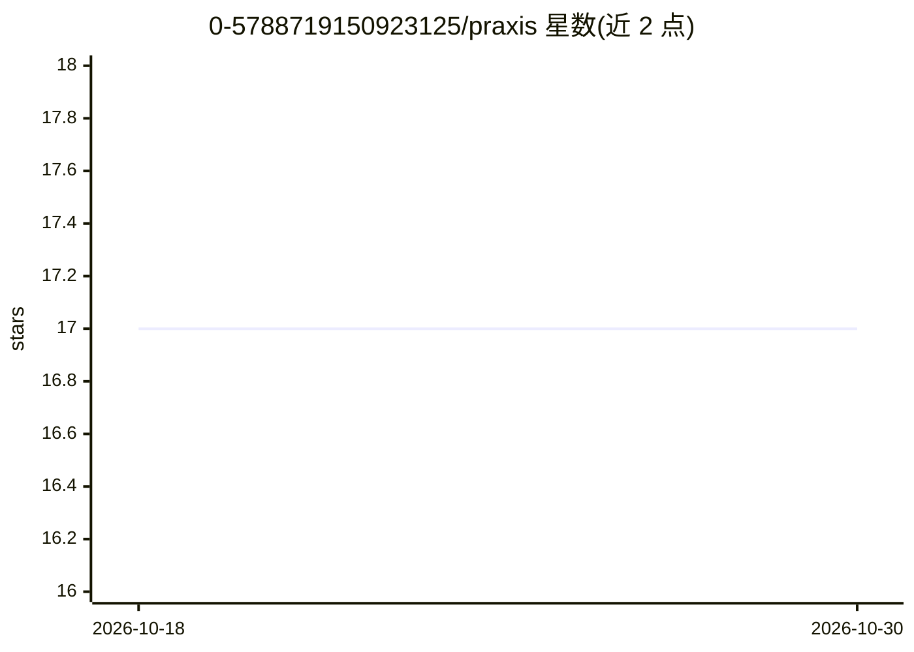

# 0-5788719150923125/praxis

⭐ 17 · Python · MIT · 推送 2026-10-24 · [GitHub](https://github.com/0-5788719150923125/praxis) · [官网](https://arc.src.eco) · 个人维护

**模块化本地优先的 AI 模型训练/服务框架，带 Web 仪表盘**

Praxis 是一个本地优先、去中心化的模型框架：以 55 个注册表命名空间组织约 300 个可组合组件（注意力机制、损失函数、优化器、PEFT、RL 策略等），通过 ./launch 脚本管理虚拟环境并启动训练，附带 Web 仪表盘、JSON 推理 API 与聊天界面。支持注册为 transformers PreTrainedModel 使 checkpoint 兼容 Auto* 类，也可用 --model-name 加载并训练任意 Hugging Face checkpoint（含 LoRA/Dora 适配器训练），--no-train 可仅做推理服务。提供 Docker compose 启动方式，建议使用 Nvidia GPU 与 batch-size≥16。

## 筛选速览

| 维度 | 判定 | 备注 |
|---|---|---|
| AI 角色 | `ai-ecosystem` | LLM/agent 周边工具 |
| 许可风险 | `permissive` | MIT |
| 部署形态 | `None` |  |
| 模型依赖 | — | README 未给出锁定关系 |
| 硬件要求 | — | 无带数字的原话,不猜 |
| 安装摩擦 | `medium` | 含编译或系统依赖之一 |
| 成熟度 | — | 结构信号不足 |

## 能力要点

- 55 个注册表命名空间组织可组合模型组件
- PraxisForCausalLM 注册后兼容 transformers Auto* 类
- 可加载任意 transformers checkpoint 并用 Praxis 目标训练（LoRA/rslora/dora 等 PEFT）
- Web 仪表盘 + JSON 推理 API + 聊天界面（localhost:2100）

## 适用场景

- 组合注册表组件搭建并训练自定义架构模型
- 用 Praxis 的数据管线与目标函数微调 Hugging Face 已发布模型
- 本地启动带仪表盘的模型训练与推理服务

## 场景标签

`微调` `模型训练` `推理引擎` · 领域:训练与推理

## 证据(README 行号)

> L9: The Praxis platform is an ever-evolving, local-first, peer-to-peer, burstable, flexible, modular, extensible and dec
> L75: - **`praxis/`** - The model framework itself. See docs/index.md for the per-registry feature map.
> L157: `PraxisForCausalLM` is a real `PreTrainedModel` + `GenerationMixin`, so once registered, any Praxis checkpoint wor

## 星数曲线

2026-10-18 17 → 2026-10-30 17（+0）

---
*卡片 v1 · prompt 1.4 · 生成 2026-10-30 · 置信度 high · 依据 README sha `4d4204cb470f` · [字段定义](../../DATASET.md)*
