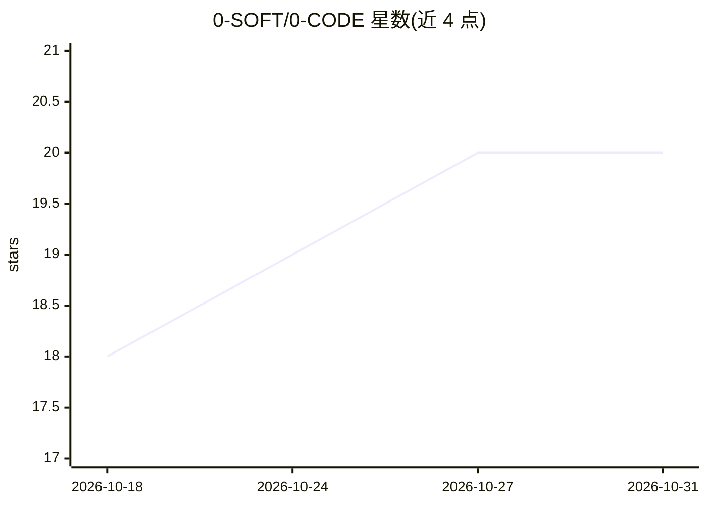

# 0-SOFT/0-CODE

⭐ 20 · JavaScript · NOASSERTION · 推送 2026-10-19 · [GitHub](https://github.com/0-SOFT/0-CODE) · 组织维护 · 中文 README

**为 Claude Code/Codex/OpenCode 添加自主开发循环的集成框架**

面向已有或新建项目的自主开发循环框架：通过本地 .0-code/ 目录为 Claude Code、Codex 和 OpenCode 三种 agent 引擎添加规划、实现、审计与发布工作的循环状态管理。集成方式为在 agent 会话中请求按 INTEGRATE.md 执行安装；提供 doctor、start、upgrade、migrate、uninstall 等 Node 命令行操作。包含九种文档角色、五个默认 MCP 服务器（context7、playwright、chrome-devtools、sequential-thinking、memory）、文档迁移与会话隔离机制。模型与登录归项目所有者，框架不复制认证。公开树不含 1.x 旧安装的自动迁移配置。

## 筛选速览

| 维度 | 判定 | 备注 |
|---|---|---|
| AI 角色 | `ai-ecosystem` | LLM/agent 周边工具 |
| 许可风险 | `none` | NOASSERTION |
| 部署形态 | `None` |  |
| 模型依赖 | — | README 未给出锁定关系 |
| 硬件要求 | — | 无带数字的原话,不猜 |
| 安装摩擦 | `low` | 无编译、无系统依赖或容器化 |
| 成熟度 | — | 结构信号不足 |

## 能力要点

- 一个循环提示可包含研究、实现、修复、审计与发布工作
- 支持 Claude Code、Codex、OpenCode 三种引擎的安装/升级/卸载统一模板
- 五个默认 MCP 服务器（context7、playwright、chrome-devtools、sequential-thinking、memory）
- 九种文档角色与 STATE 机器可读状态，文档迁移支持 --dry-run

## 适用场景

- 在现有项目中为我的 agent 引擎加入可追踪的开发循环
- 统一管理 Claude Code/Codex/OpenCode 项目的规划、审计与发布文档
- 对旧版本 .0-code 安装执行带 SHA-256 校验的迁移与收养

## 场景标签

`编码 Agent` `Agent 框架` · 领域:Agent 开发

## 证据(README 行号)

> L5: An autonomous development cycle for **Claude Code, Codex and OpenCode**, integrated into an existing project. One cy
> L17: Framework code, configuration, schemas, modules and built-in templates live in **`.0-code/`**. Project-owned cycle 

## 星数曲线

2026-10-18 18 → 2026-10-31 20（+2）

---
*卡片 v1 · prompt 1.4 · 生成 2026-10-28 · 置信度 high · 依据 README sha `20068e1a3c08` · [字段定义](../../DATASET.md)*
