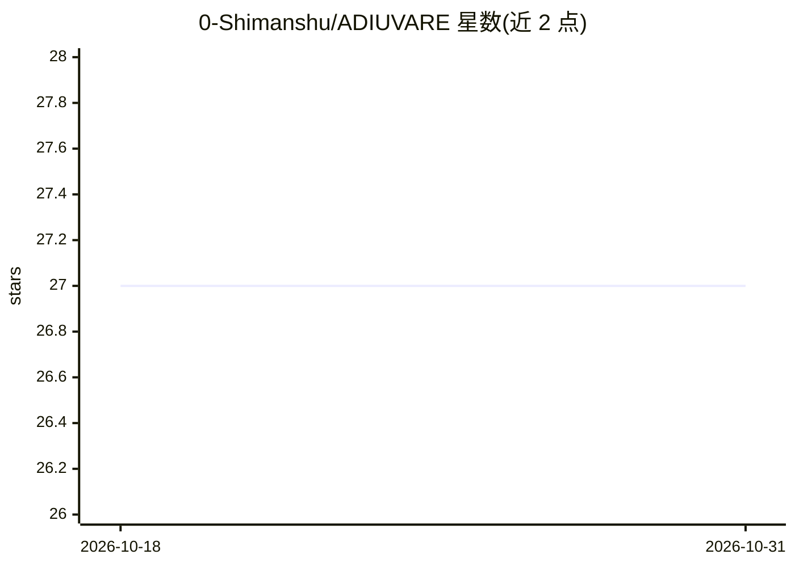

# 0-Shimanshu/ADIUVARE

⭐ 27 · Python · Apache-2.0 · 推送 2026-08-04 · [GitHub](https://github.com/0-Shimanshu/ADIUVARE) · 个人维护

**给 Python Web 开发者的进程内 API 风险评分安全层**

嵌入 FastAPI/Flask/Django 应用进程的请求安全层：请求到达业务处理器前，先经 trackA 快速硬门（封禁/白名单/明显拦截），再由 trackB 对载荷、行为、身份、上下文与 IP 信誉做多信号综合风险评分，输出 allow/flag/throttle/block 分级处置，并留下本地审计记录。配套 adv CLI 与 TUI 用于运行时观察与运维操作（封禁 IP、查看事件、配置调整）。存储默认 SQLite，可选 Redis 后端；AI 评审为可选模式（默认 off，有 off/assist/critical 与超时配置）。通过 pip 从源码安装，需 Python 3.11+。限制：分布式共享状态与断连 TUI 语义仍有边界，载荷检测目前集中在 SQLi/XSS/路径遍历模式。

## 筛选速览

| 维度 | 判定 | 备注 |
|---|---|---|
| AI 角色 | `ai-enhanced` | 去掉 AI 部分产品仍成立 |
| 许可风险 | `permissive` | Apache-2.0 |
| 部署形态 | `library` | 以包/库形式分发 |
| 模型依赖 | — | README 未给出锁定关系 |
| 硬件要求 | — | 无带数字的原话,不猜 |
| 安装摩擦 | `low` | 无编译、无系统依赖或容器化 |
| 成熟度 | — | 结构信号不足 |

## 能力要点

- trackA 硬门 + trackB 多信号评分的双管道请求检查，产出 allow/flag/throttle/block 分级判定
- adv CLI 与内置 TUI 提供本地运行时观察与运维操作（Monitor/Events/Signals/AI/Audit 等界面）
- SQLite 默认存储，Redis 为可选后端
- 可选 AI 评审模式（off/assist/critical，带请求时超时配置）

## 适用场景

- 在 FastAPI/Flask/Django 应用内对高风险路由（如支付接口）做分级拦截与限流
- 对可疑请求做标记或密切监视而非直接封禁，降低误伤
- 本地留存每条请求决策的审计记录并按需封禁/解封 IP

## 场景标签

`网络安全` · 领域:学习与行业

## 证据(README 行号)

> L13: Adiuvare is an in-process security layer for Python APIs. It sits inside your
> L58: - `trackB` scores the requests that still pass using payload, behavior,
> L62: signal.

## 星数曲线

2026-10-18 27 → 2026-10-31 27（+0）

---
*卡片 v1 · prompt 1.4 · 生成 2026-10-26 · 置信度 high · 依据 README sha `e0bf212287be` · [字段定义](../../DATASET.md)*
