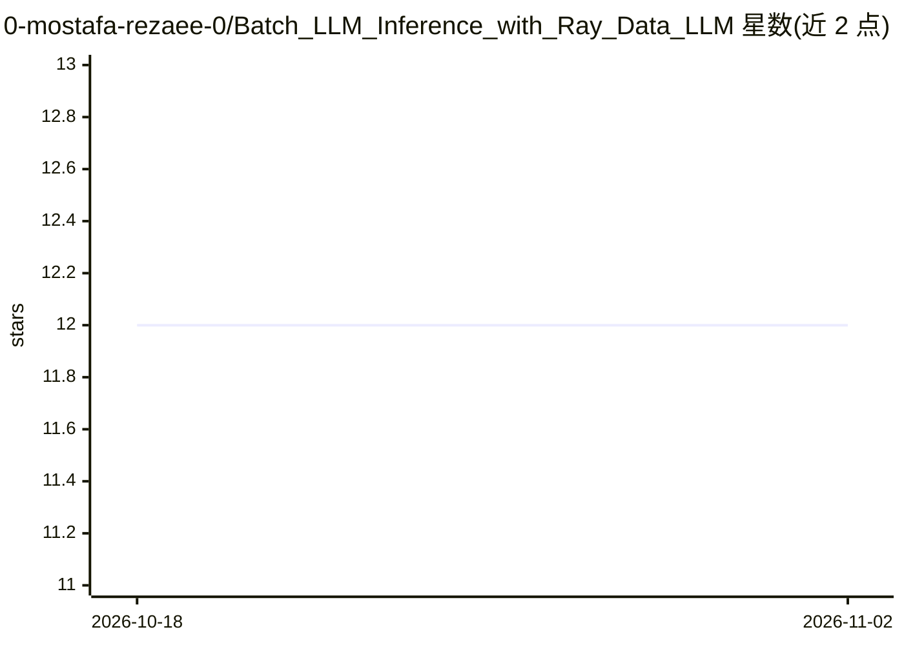

# 0-mostafa-rezaee-0/Batch_LLM_Inference_with_Ray_Data_LLM

⭐ 12 · Jupyter Notebook · MIT · 推送 2026-02-12 · [GitHub](https://github.com/0-mostafa-rezaee-0/Batch_LLM_Inference_with_Ray_Data_LLM) · 个人维护

**面向 ML 工程师的 Ray Data LLM 批量推理教程模板仓库**

演示如何使用 Ray Data LLM 对大语言模型执行批量推理的教学型模板仓库，从基础问答生成、批量文本生成进阶到社交媒体情感分析等实际场景。内容覆盖 Ray 分布式计算概念、Ray Data LLM Processor 配置、vLLM 引擎副本与连续批处理机制、Ray Serve LLM 在线部署 API，以及 OpenAI 兼容端点集成。面向 ML 工程师、数据科学家、NLP 研究者与 DevOps 工程师，通过 Use this template 按钮创建副本后自由修改，仓库含 Docker 配置的 Ray 集群目录。

## 筛选速览

| 维度 | 判定 | 备注 |
|---|---|---|
| AI 角色 | `ai-knowledge` | 知识聚合/清单类 |
| 许可风险 | `permissive` | MIT |
| 部署形态 | `self-host` | docker 或自建部署 |
| 模型依赖 | — | README 未给出锁定关系 |
| 硬件要求 | — | 无带数字的原话,不猜 |
| 安装摩擦 | `low` | 无编译、无系统依赖或容器化 |
| 成熟度 | — | 结构信号不足 |

## 能力要点

- 从基础到进阶的批量 LLM 推理分层教程（问答/文本生成/情感分析）
- 覆盖 Ray Data LLM Processor 与 vLLM 引擎副本、连续批处理机制
- 包含 Ray Serve LLM 在线部署（自动扩缩容、多 LoRA、OpenAI 兼容）
- 以 GitHub 模板形式提供，可直接创建副本修改

## 适用场景

- 我要为生产应用扩展 LLM 批量推理吞吐量
- 我要学习 Ray 分布式批处理与 vLLM 集成方法
- 我要对大规模文本数据集批量做情感分析或文本生成

## 场景标签

`教程课程` `推理引擎` · 领域:学习与行业

## 证据(README 行号)

> L15: This project demonstrates how to perform batch inference with Large Language Models (LLMs) using Ray Data LLM. It p
> L65: In this tutorial, we will start with a straightforward problem to introduce the concept of batch inference with Ray

## 星数曲线

2026-10-18 12 → 2026-11-02 12（+0）

---
*卡片 v1 · prompt 1.4 · 生成 2026-11-01 · 置信度 high · 依据 README sha `b592e573b1c8` · [字段定义](../../DATASET.md)*
