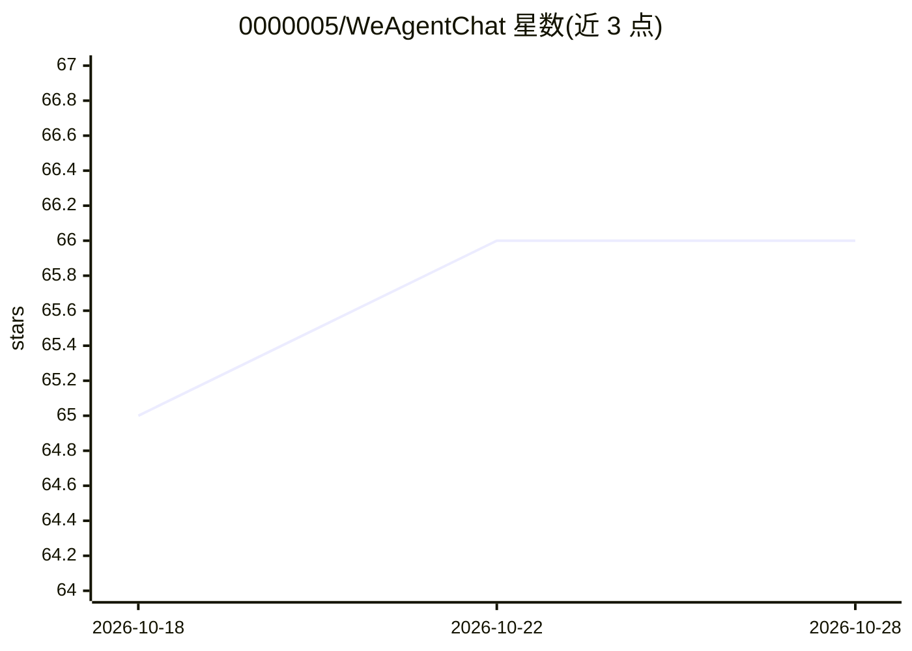

# 0000005/WeAgentChat

⭐ 66 · Python · 推送 2026-07-27 · [GitHub](https://github.com/0000005/WeAgentChat) · [官网](https://weagentchat.pages.dev/) · 组织维护 · 中文 README

**本地优先的 AI 陪伴聊天应用，AI 好友带长期记忆**

微信风格的 AI 社交模拟桌面应用：每个 AI 好友通过双轨长期记忆系统（全局 Profile 画像 + 事件级 RAG 卡片，sqlite-vec 本地向量索引）记住用户性格与生活事件，30 分钟无活动自动归档会话、再聊自动延续。支持一句话生成人设、多 AI 群聊、语音消息。数据全部存于本地 SQLite。用户需自行在设置中填入 OpenAI 兼容 LLM API Key（README 推荐 DeepSeek）。Windows 提供 .exe 安装包，开发者可从源码（Node.js + Python + Electron）运行。

## 筛选速览

| 维度 | 判定 | 备注 |
|---|---|---|
| AI 角色 | `ai-native` | 本体是模型或模型工具 |
| 许可风险 | `permissive` | — |
| 部署形态 | `desktop` | 安装包/桌面程序 |
| 模型依赖 | — | README 未给出锁定关系 |
| 硬件要求 | — | 无带数字的原话,不猜 |
| 安装摩擦 | `low` | 无编译、无系统依赖或容器化 |
| 成熟度 | — | 结构信号不足 |

## 能力要点

- 双轨长期记忆：全局 Profile 画像 + 事件级 RAG 卡片
- sqlite-vec 本地向量索引，数据不出设备
- 被动式会话流：无活动自动归档，再聊自动延续
- 智能创建好友、多 AI 群聊与语音消息

## 适用场景

- 找一个记得住我的生活细节、能延续话题的 AI 好友倾诉
- 把多个 AI 好友拉进群聊，观察不同人设的观点碰撞
- 本地存储隐私数据，在设备上运行私人 AI 社交沙盒

## 场景标签

`聊天机器人` · 领域:对话与助手

## 证据(README 行号)

> L7:  An AI companion platform with long-term memory — where every AI friend truly knows you.
> L36: - **有记忆的 AI 社交模拟器**：模拟真实社交场景，AI 会记住你的性格、喜好和生活点滴。
> L66:  🧠 双轨长期记忆

## 星数曲线

2026-10-18 65 → 2026-10-28 66（+1）

---
*卡片 v1 · prompt 1.4 · 生成 2026-10-24 · 置信度 mid · 依据 README sha `e2e985272e06` · [字段定义](../../DATASET.md)*
