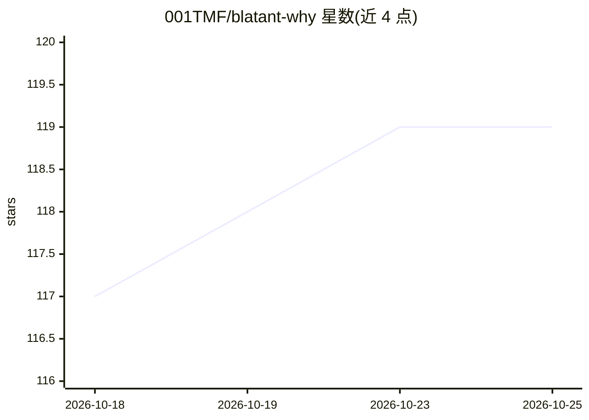

# 001TMF/blatant-why

⭐ 119 · Python · MIT · 推送 2026-10-16 · [GitHub](https://github.com/001TMF/blatant-why) · 个人维护

**科研人员的蛋白质/抗体设计多智能体活动编排框架（Claude Code 上运行）**

开源蛋白质设计 agent，作为 Claude Code 的编排层运行：通过 npx 初始化脚手架后，提供 11 个 MCP 服务器（PDB/UniProt/SAbDab 数据库、计算调度、筛选等）、21 个 agent 与 19 个 skill，覆盖靶点研究、设计生成（BoltzGen/Protenix/PXDesign）、筛选评分与实验室结果回灌闭环。计算默认本地 NVIDIA GPU（需 CUDA），可选 RunPod/Modal/SLURM/Tamarind Bio 云端。依赖 Node.js 18+ 与 Python 3.11+。版本为 v0.1.0-beta。

## 筛选速览

| 维度 | 判定 | 备注 |
|---|---|---|
| AI 角色 | `ai-ecosystem` | LLM/agent 周边工具 |
| 许可风险 | `permissive` | MIT |
| 部署形态 | `library` | 以包/库形式分发 |
| 模型依赖 | locked-api |  |
| 硬件要求 | — | 无带数字的原话,不猜 |
| 安装摩擦 | `medium` | 含编译或系统依赖之一 |
| 成熟度 | `idea` | |

## 能力要点

- 11 个 MCP 服务器 + 21 个 agent + 19 个 skill 的多智能体编排
- 整合 BoltzGen/Protenix/PXDesign 等开源设计工具，默认本地 GPU 无需云服务
- 湿实验 CSV 结果回灌与失败诊断（Mann-Whitney U、主动学习优化）
- 支持本地 GPU/RunPod/Modal/SLURM/SSH/Tamarind 多种计算后端

## 适用场景

- 针对给定靶点蛋白运行抗体/纳米抗体/novo binder 设计活动
- 无本地 GPU 时通过 Tamarind Bio 免费层做预览级设计
- 将湿实验结果导回系统校准下一轮设计

## 场景标签

`多智能体` `科研工具` · 领域:Agent 开发

## 证据(README 行号)

> L10:  Open-source protein design agent for Claude Code
> L39: This scaffolds everything: 11 MCP servers, 21 agents, 19 skills, 13 slash commands, and a CLAUDE.md orchestration f
> L86: |MCP Servers|11|Biological databases, compute (local + HPC + cloud), screening, campaign state, knowledge store|

## 星数曲线

2026-10-18 117 → 2026-10-25 119（+2）

---
*卡片 v1 · prompt 1.4 · 生成 2026-10-23 · 置信度 mid · 依据 README sha `9714d0e0ce56` · [字段定义](../../DATASET.md)*
