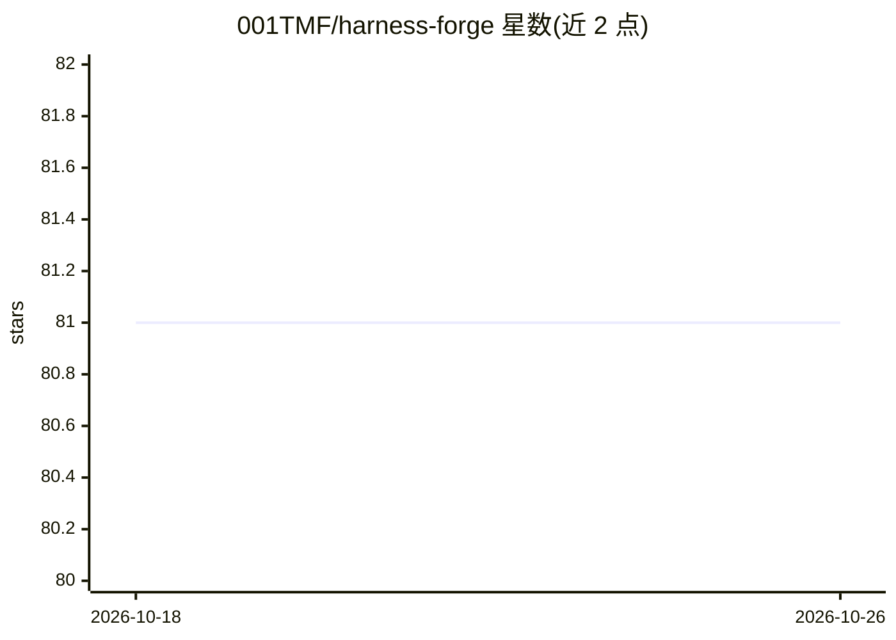

# 001TMF/harness-forge

⭐ 81 · Python · MIT · 推送 2026-06-14 · [GitHub](https://github.com/001TMF/harness-forge) · 个人维护

**Claude Code 技能：通过 propose→score→Pareto 循环优化模型外围脚手架**

以 Claude Code skill/plugin 形式提供的 harness 优化循环：并行 proposer agent 生成候选脚手架变体（记忆、检索、上下文构造、摘要、prompt 模板、工具选择逻辑），经确定性 $0 评分器打分，保留 Pareto 前沿最优并迭代；基础模型保持冻结。是 Meta-Harness（Lee et al. 2026）方法的原生重实现，将原 ~1,260 行 Python 驱动改写为原生 Workflow 编排，约 75 行。用户需自供候选接口、确定性评分器、评测语料、proposer 先验与前沿状态。不适用于需改模型权重的场景（应走 RL/微调）。

## 筛选速览

| 维度 | 判定 | 备注 |
|---|---|---|
| AI 角色 | `ai-ecosystem` | LLM/agent 周边工具 |
| 许可风险 | `permissive` | MIT |
| 部署形态 | `None` |  |
| 模型依赖 | locked-api |  |
| 硬件要求 | — | 无带数字的原话,不猜 |
| 安装摩擦 | `low` | 无编译、无系统依赖或容器化 |
| 成熟度 | — | 结构信号不足 |

## 能力要点

- propose→score→Pareto 前沿的端到端 harness 优化循环，模型冻结
- Meta-Harness (Lee et al. 2026) 的 Claude Code 原生重实现（~75 行 vs 原 ~1,260 行）
- $0 确定性评分器，无 solver 模型与按量计费 API
- 内置冻结重放缺陷（frozen-replay defect）检测方法与留出集纪律

## 适用场景

- 基础模型固定、需从脚手架侧获得提升的重复性任务
- 优化上下文膨胀、检索质量、有损摘要或脆弱的 prompt 脚手架
- 在 Claude Code 内复现 Meta-Harness 论文的 harness 侧优化实验

## 场景标签

`提示工程` · 领域:Agent 开发

## 证据(README 行号)

> L9: Harness Forge is a Claude Code skill that runs an end-to-end
> L21: logic — a cheap scorer — and expresses the entire outer loop as native orchestration. The whole
> L56: The only thing you still write is the **cheap scorer + rubric + candidate interface**. Everything

## 星数曲线

2026-10-18 81 → 2026-10-26 81（+0）

---
*卡片 v1 · prompt 1.4 · 生成 2026-10-24 · 置信度 high · 依据 README sha `33a34f63592e` · [字段定义](../../DATASET.md)*
