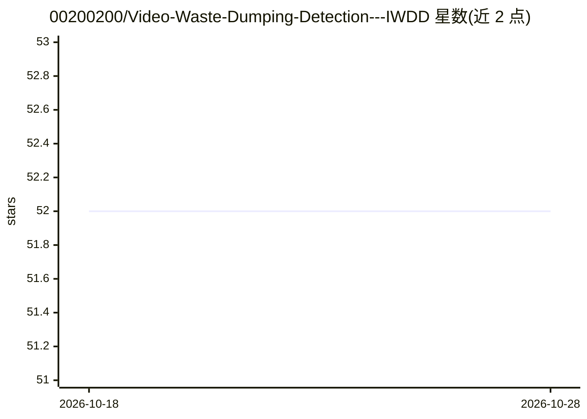

# 00200200/Video-Waste-Dumping-Detection---IWDD

⭐ 52 · Jupyter Notebook · 推送 2026-10-28 · [GitHub](https://github.com/00200200/Video-Waste-Dumping-Detection---IWDD) · 个人维护

**非法倾倒垃圾视频检测的分类训练管线（IWDD 竞赛）**

面向 IWDD 竞赛的非法垃圾倾倒视频分类训练管线，基于 PyTorch Lightning 实现，提供 VideoMAE（SSv2/Kinetics）与 X-CLIP 四种预配置模型，通过 config/models_config.yaml 选择；训练参数（模型、epochs、batch-size 等）经 CLI 传入，指标以 TensorBoard 记录，按验证损失保存最优 checkpoint 至 lightning_logs。使用 uv 管理依赖，从源码克隆运行；文档另含多数据集训练 YOLO 模型的指南。

## 筛选速览

| 维度 | 判定 | 备注 |
|---|---|---|
| AI 角色 | `ai-native` | 本体是模型或模型工具 |
| 许可风险 | `none` | — |
| 部署形态 | `None` |  |
| 模型依赖 | — | README 未给出锁定关系 |
| 硬件要求 | — | 无带数字的原话,不猜 |
| 安装摩擦 | `low` | 无编译、无系统依赖或容器化 |
| 成熟度 | — | 结构信号不足 |

## 能力要点

- VideoMAE-SSv2/Kinetics 与 X-CLIP 多模型可选
- CLI 配置训练参数，TensorBoard 监控
- 按验证损失自动保存最优 checkpoint
- 附 YOLO 多数据集训练指南

## 适用场景

- 我在 IWDD 竞赛中训练非法倾倒垃圾检测模型
- 我需要对比 VideoMAE 与 X-CLIP 在视频分类上的表现
- 我基于该管线微调自己的动作识别模型

## 场景标签

`微调` `目标检测` · 领域:感知与多模态

## 证据(README 行号)

> L26: # Train default model (VideoMAE-SSv2)
> L32: **Available models:** `videomae_ssv2` `videomae_ssv2_shrot`, `videomae_kinetics`, `xclip` (configured in `config/mo

## 星数曲线

2026-10-18 52 → 2026-10-28 52（+0）

---
*卡片 v1 · prompt 1.4 · 生成 2026-10-24 · 置信度 high · 依据 README sha `6e68972f8d42` · [字段定义](../../DATASET.md)*
