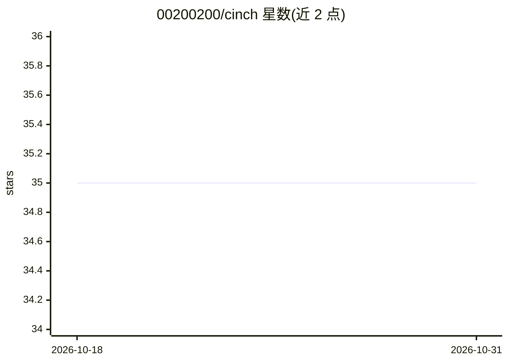

# 00200200/cinch

⭐ 35 · Python · MIT · 推送 2026-10-28 · [GitHub](https://github.com/00200200/cinch) · 个人维护

**跨 11 种 AI 编程客户端统一分发技能与 Agent 的 CLI**

面向使用多种 AI 编程助手（Claude Code、Cursor、Codex、Copilot、Gemini CLI 等）的开发者的 Python CLI 工具：扫描本地已有的 skills/agents/commands，通过各 harness 原生格式适配器翻译并写入对应目录（如 .claude/skills/、.agents/skills/、.gemini/commands/）。提供交互式向导与 CLI 旗标，含信任策略与来源审计（检查许可证、可执行脚本、路径逃逸，不执行仓库代码）、.cinch.json 操作清单、dry-run 预览。纯本地运行，无遥测与网络请求；超出目标工具字符限制或带脚本资源时改用指针文件方式。

## 筛选速览

| 维度 | 判定 | 备注 |
|---|---|---|
| AI 角色 | `ai-ecosystem` | LLM/agent 周边工具 |
| 许可风险 | `permissive` | MIT |
| 部署形态 | `library` | 以包/库形式分发 |
| 模型依赖 | — | README 未给出锁定关系 |
| 硬件要求 | — | 无带数字的原话,不猜 |
| 安装摩擦 | `low` | 无编译、无系统依赖或容器化 |
| 成熟度 | — | 结构信号不足 |

## 能力要点

- 支持 11 种 harness 的技能格式互译（Claude Code、Cursor、Codex、Copilot、Gemini CLI、Windsurf、Cline、OpenCode、Aider、Zed、Continue、Grok）
- 静态来源审计：检查许可证、可执行脚本与路径逃逸，不执行仓库代码
- 每次运行生成 .cinch.json 文件写入/合并/跳过清单，支持 dry-run 预览
- 100% 本地运行，无遥测与网络请求

## 适用场景

- 在多个 AI 编程客户端之间复用同一套技能与 Agent 配置
- 团队内统一分发自定义工作流技能到不同工具
- 安装外部技能前做许可证与脚本安全审计

## 场景标签

`提示工程` · 领域:Agent 开发

## 证据(README 行号)

> L33: **Cinch is the universal translation bridge.** It scans your existing local skills and agents, translates them thro
> L158: |**Claude Code**|`.claude/skills/<n>/SKILL.md`|Verbatim passthrough|Native Anthropic skill format|

## 星数曲线

2026-10-18 35 → 2026-10-31 35（+0）

---
*卡片 v1 · prompt 1.4 · 生成 2026-10-25 · 置信度 high · 依据 README sha `b95d9e886809` · [字段定义](../../DATASET.md)*
