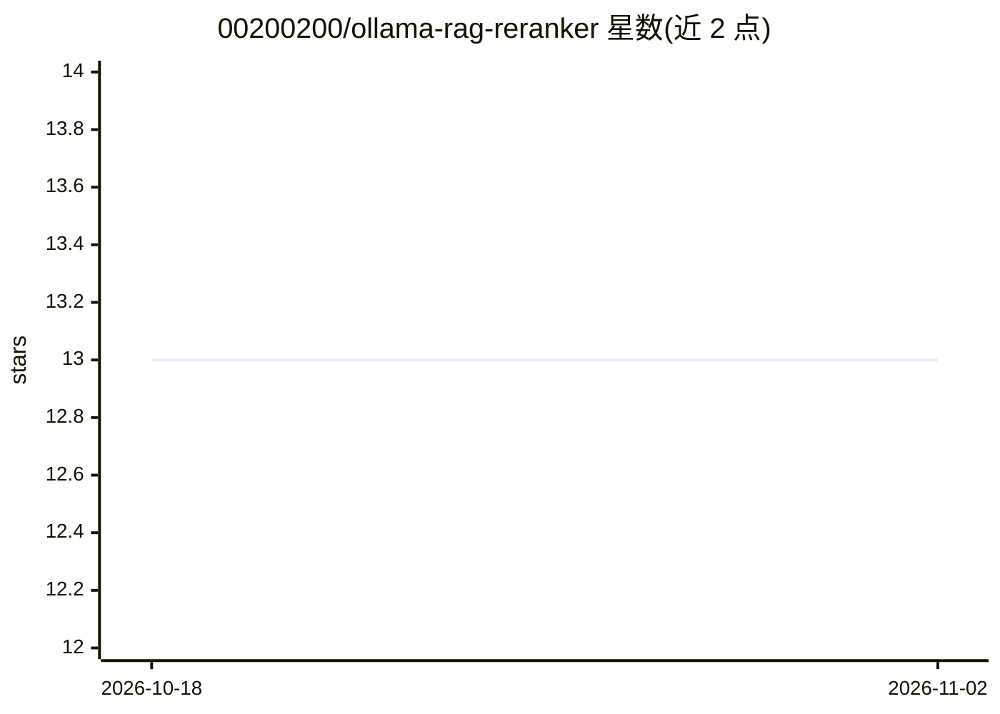

# 00200200/ollama-rag-reranker

⭐ 13 · Python · 推送 2026-10-28 · [GitHub](https://github.com/00200200/ollama-rag-reranker) · 个人维护

**交互式 CLI：用 Ollama 做 RAG 问答并对比有无重排序**

命令行实验程序：用 Ollama 生成嵌入与最终回答，HNSWVectorDB 做向量检索，可选加载 FlagEmbedding 的 BAAI/bge-reranker-base 对候选段落重打分。交互菜单可调整上下文段落数并在 none/rerank/both 三种模式间切换，用于在小语料上比较有/无重排序的检索效果。需 Python 3.11+、uv 与本地运行的 Ollama 服务器，从源码运行。限制：即使选 none 模式也会在导入时加载重排模型并可能下载权重。

## 筛选速览

| 维度 | 判定 | 备注 |
|---|---|---|
| AI 角色 | `ai-native` | 本体是模型或模型工具 |
| 许可风险 | `none` | — |
| 部署形态 | `None` |  |
| 模型依赖 | local-ok | 支持本地模型 |
| 硬件要求 | — | 无带数字的原话,不猜 |
| 安装摩擦 | `low` | 无编译、无系统依赖或容器化 |
| 成熟度 | — | 结构信号不足 |

## 能力要点

- Ollama 提供嵌入与聊天生成
- HNSW 索引做向量检索，BAAI/bge-reranker-base 可选重排序
- 交互菜单切换 none/rerank/both 模式并调整上下文数量
- 通过修改源码内配置项切换默认模型

## 适用场景

- 在小语料上比较有/无重排序的 RAG 检索效果
- 本地跑通一个带重排序的最小 RAG 流程
- 调整上下文段落数观察回答变化

## 场景标签

`RAG` · 领域:知识与检索

## 证据(README 行号)

> L3: A command-line experiment for comparing retrieval with and without reranking on a small text corpus. It uses:
> L31: - `src/rag/llm.py`: Generates the final answer from context using an Ollama chat model.

## 星数曲线

2026-10-18 13 → 2026-11-02 13（+0）

---
*卡片 v1 · prompt 1.4 · 生成 2026-10-31 · 置信度 high · 依据 README sha `785ad5cb0bad` · [字段定义](../../DATASET.md)*
