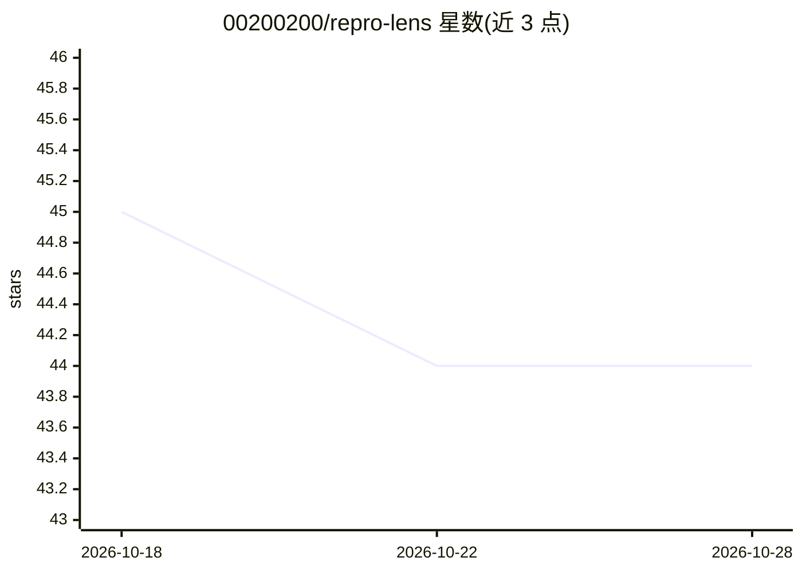

# 00200200/repro-lens

⭐ 44 · Python · MIT · 推送 2026-10-28 · [GitHub](https://github.com/00200200/repro-lens) · [官网](https://00200200.github.io/repro-lens/) · 个人维护

**ML 代码可复现性静态检查与实验回放比对工具**

面向 ML 开发者与 AI 编程代理的 Python 命令行工具：静态分析 ML 代码定位非确定性风险（如缺少 random_state），提供 verify 比对两次运行的声明输出（指标、产物哈希、日志），compare 检查改动前后输出是否一致，agent-review 输出机器可读的风险判定。内置 scikit-learn、XGBoost、LightGBM、PyTorch、TensorFlow、Lightning 规则，静态分析无需 ML 依赖或 API key，支持 --fix 自动加种子、pre-commit 钩子、LSP 诊断与 agent 技能。

## 筛选速览

| 维度 | 判定 | 备注 |
|---|---|---|
| AI 角色 | `ai-ecosystem` | LLM/agent 周边工具 |
| 许可风险 | `permissive` | MIT |
| 部署形态 | `None` |  |
| 模型依赖 | — | README 未给出锁定关系 |
| 硬件要求 | — | 无带数字的原话,不猜 |
| 安装摩擦 | `low` | 无编译、无系统依赖或容器化 |
| 成熟度 | — | 结构信号不足 |

## 能力要点

- 静态分析毫秒级发现非确定性风险，无需 ML 依赖或 API key
- check/verify/compare/agent-review/lsp 五个核心命令
- 原生规则覆盖 sklearn/XGBoost/LightGBM/PyTorch/TensorFlow/Lightning
- 提供 --diff/--fix 自动种子建议、pre-commit 钩子与 agent 技能

## 适用场景

- 重构 ML 训练代码后核验输出是否与改动前一致
- 提交前用 pre-commit 钩子拦截非确定性代码
- 让 AI 编程代理自动审计并修复可复现性问题

## 场景标签

`MLOps` · 领域:训练与推理

## 证据(README 行号)

> L15: Catch reproducibility risks before a commit, replay an experiment, and compare outputs before and after a change. B
> L23: Machine Learning code is notorious for silent reproducibility failures. Repro Lens statically analyzes your ML code

## 星数曲线

2026-10-18 45 → 2026-10-28 44（-1）

---
*卡片 v1 · prompt 1.4 · 生成 2026-10-25 · 置信度 high · 依据 README sha `edd23a9bb2e2` · [字段定义](../../DATASET.md)*
