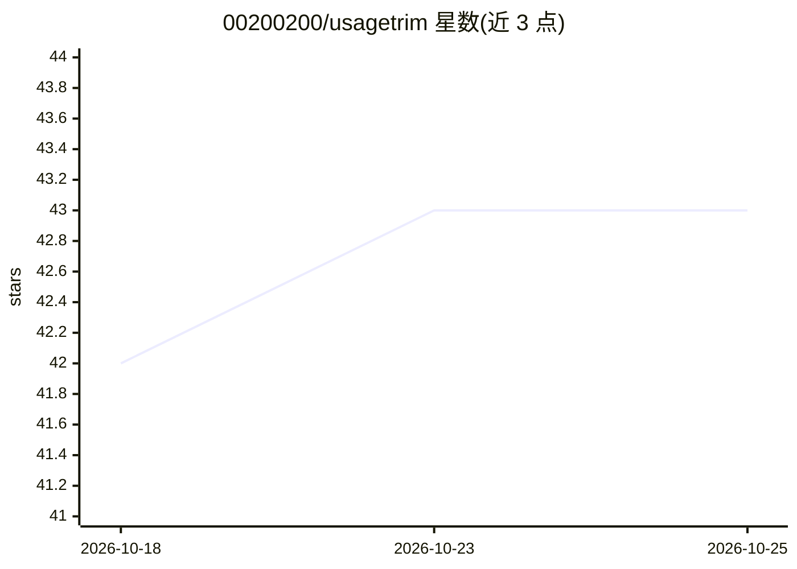

# 00200200/usagetrim

⭐ 43 · Python · MIT · 推送 2026-10-22 · [GitHub](https://github.com/00200200/usagetrim) · [官网](https://00200200.github.io/usagetrim/) · 个人维护

**压缩测试与构建日志输出的本地 CLI 与 MCP 工具**

面向 Claude Code、Codex、Cursor、Claude Desktop 等 AI 编程助手的输出压缩工具：以 CLI 包装（usagetrim run）或 MCP 形式介入工具输出路径，用针对 pytest、Docker、cargo、go、terraform 等的专用过滤器折叠冗余文本、保留失败信号，被裁剪内容存入本地缓存可按引用恢复，并提供会话去重、超限转存文件与按工具族的节省统计（usagetrim gain）。附带可选的 macOS 菜单栏宠物应用。需要 Python 3.11+ 与 uv。

## 筛选速览

| 维度 | 判定 | 备注 |
|---|---|---|
| AI 角色 | `ai-ecosystem` | LLM/agent 周边工具 |
| 许可风险 | `permissive` | MIT |
| 部署形态 | `self-host` | docker 或自建部署 |
| 模型依赖 | — | README 未给出锁定关系 |
| 硬件要求 | — | 无带数字的原话,不猜 |
| 安装摩擦 | `low` | 无编译、无系统依赖或容器化 |
| 成熟度 | — | 结构信号不足 |

## 能力要点

- 针对 pytest/Docker/cargo/go/terraform 等的专用日志压缩过滤器，失败信息保留、其余可经 usagetrim retrieve 恢复
- 无损重写其他 MCP 服务器的 JSON 输出（转为 TSV 等），并配套 scout/runner Haiku 子代理
- 会话去重（~15 分钟内相同输出转为缓存引用）与超过 ~20 KiB 载荷转存文件
- 按工具族统计 Raw→Compact token 节省（本地 o200k_base 估算）

## 适用场景

- 让 AI 编程助手读取精简后的测试与构建日志，减少上下文占用
- 压缩其他 MCP 服务器返回的冗长 JSON 结果
- 粘贴杂乱日志到桌面 AI 应用前先做预处理（prepare for chat）

## 场景标签

 · 领域:开发者工具/AI 上下文管理

## 证据(README 行号)

> L4:  Local CLI + MCP that folds verbose tool output for Claude Code, Codex, Cursor, and Claude Desktop — recoverable by 
> L112: UsageTrim is **not** a chat interceptor. It sits on the tool path (CLI wrapper, MCP, Prepare-for-chat) so agents s
> L116: |Blind head/tail truncation|Specialized cutters keep the failure signal; rest recovers via `usagetrim retrieve`|

## 星数曲线

2026-10-18 42 → 2026-10-25 43（+1）

---
*卡片 v1 · prompt 1.4 · 生成 2026-10-25 · 置信度 mid · 依据 README sha `730187e1c890` · [字段定义](../../DATASET.md)*
