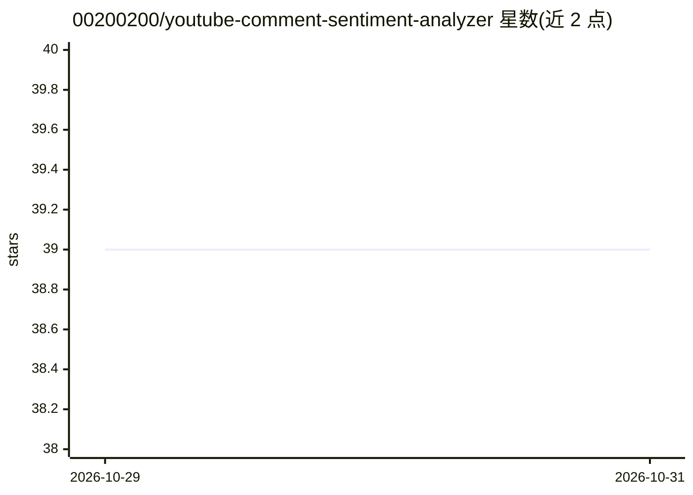

# 00200200/youtube-comment-sentiment-analyzer

⭐ 39 · TypeScript · 推送 2026-10-28 · [GitHub](https://github.com/00200200/youtube-comment-sentiment-analyzer) · 个人维护

**分析 YouTube 评论情感的全栈 Web 应用（FastAPI+React）**

Emotube 是实验性全栈 Web 应用：通过 YouTube Data API 拉取视频元数据与顶层评论，用预训练 Hugging Face 模型（cardiffnlp/twitter-xlm-roberta-base-sentiment）分类为正面/中性/负面/模糊（分数低于 0.6 记为 ambiguous），结果存入 PostgreSQL，React 前端展示图表与过滤。Docker Compose 编排前端、后端、数据库；API 无鉴权、CORS 全开，README 声明这是本地开发配置而非生产模板。仅支持 YouTube 平台，不抓取评论回复。

## 筛选速览

| 维度 | 判定 | 备注 |
|---|---|---|
| AI 角色 | `ai-native` | 本体是模型或模型工具 |
| 许可风险 | `none` | — |
| 部署形态 | `self-host` | docker 或自建部署 |
| 模型依赖 | — | README 未给出锁定关系 |
| 硬件要求 | — | 无带数字的原话,不猜 |
| 安装摩擦 | `low` | 无编译、无系统依赖或容器化 |
| 成熟度 | `idea` | |

## 能力要点

- YouTube 评论情感分类（cardiffnlp/twitter-xlm-roberta-base 模型，<0.6 分标 ambiguous）
- FastAPI 后台任务抓取分类，前端 3 秒轮询状态
- Docker Compose 一键运行前端、后端、PostgreSQL 三服务
- 评论按情感/作者/点赞/关键词过滤与时间线图表

## 适用场景

- 输入 YouTube 视频链接查看评论情感分布图表
- 按情感、作者或关键词筛选和排序视频评论
- 本地开发环境运行一个端到端的情感分析演示

## 场景标签

`数据分析` · 领域:效率与自动化

## 证据(README 行号)

> L15: Emotube fetches YouTube video metadata and top-level comments through the YouTube Data API, classifies comments wit
> L74: - **🤖 Transformers & PyTorch** - Pretrained sentiment classifier
> L225: - **🤖 Model** - `cardiffnlp/twitter-xlm-roberta-base-sentiment`, configured in `config.py`

## 星数曲线

2026-10-29 39 → 2026-10-31 39（+0）

---
*卡片 v1 · prompt 1.4 · 生成 2026-10-28 · 置信度 high · 依据 README sha `de3a840ec7b4` · [字段定义](../../DATASET.md)*
