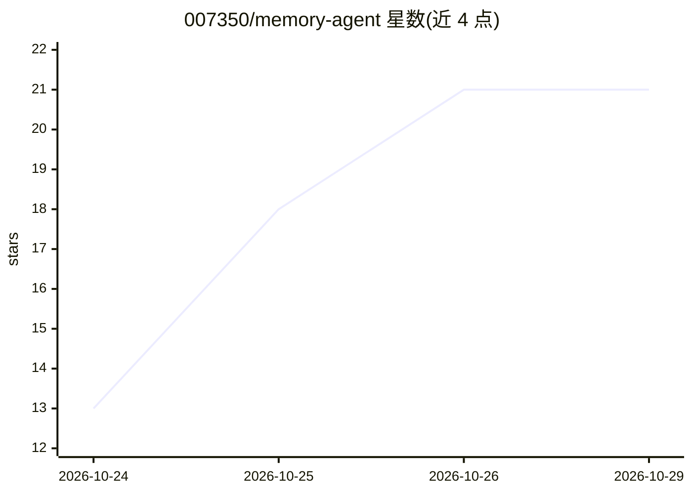

# 007350/memory-agent

⭐ 21 · Python · MIT · 推送 2026-10-23 · [GitHub](https://github.com/007350/memory-agent) · [官网](https://007350.github.io/memory-agent/) · 个人维护 · 中文 README

**AI/计算机科学学习助手：多智能体问答+图谱RAG+三层记忆**

面向学习 AI/计算机科学用户的多智能体知识助手，基于 LangGraph 路由、LightRAG 图谱 RAG、FastAPI 后端与 React 前端。轻量模型将问题分类到知识/编程/视觉/路线图/诊断/通用六类智能体；支持生成并追踪 5-10 步学习路线图、结合进度与记忆生成学习诊断报告；三层记忆全部基于 SQLite，语义去重、时间衰减加权检索。图数据库或嵌入 API 不可用时降级为纯 LLM 或关键词检索。已知限制：单用户无鉴权、python_repl 非真实沙箱、首答延迟 10-30 秒。

## 筛选速览

| 维度 | 判定 | 备注 |
|---|---|---|
| AI 角色 | `ai-native` | 本体是模型或模型工具 |
| 许可风险 | `permissive` | MIT |
| 部署形态 | `self-host` | docker 或自建部署 |
| 模型依赖 | — | README 未给出锁定关系 |
| 硬件要求 | — | 无带数字的原话,不猜 |
| 安装摩擦 | `low` | 无编译、无系统依赖或容器化 |
| 成熟度 | — | 结构信号不足 |

## 能力要点

- 多智能体路由（6 类意图，关键词回退防误路由）
- 三层 SQLite 记忆：会话记忆/长期画像/事件日志，加权混合检索
- 学习路线图生成与逐步进度追踪、学习诊断报告
- 依赖服务不可用时降级运行而非崩溃

## 适用场景

- 搭建个人 AI/CS 学习知识库并进行图谱 RAG 问答
- 让系统为我规划学习路线并追踪完成进度
- 获得基于学习记录的优势/薄弱点诊断报告

## 场景标签

`RAG` `多智能体` `知识库管理` · 领域:Agent 开发

## 证据(README 行号)

> L11: A multi-agent knowledge assistant for learning AI / Computer Science, built on **LangGraph + LightRAG + FastAPI + R
> L23: |**Multi-agent routing**|A light model classifies every question into `knowledge` / `coding` / `vision` / `roadmap`
> L25: |**Learning roadmap**|Extracts the topic, retrieves from the knowledge base, generates a 5–10 step plan, persists i

## 星数曲线

2026-10-24 13 → 2026-10-29 21（+8）

---
*卡片 v1 · prompt 1.4 · 生成 2026-10-28 · 置信度 high · 依据 README sha `0fa595359769` · [字段定义](../../DATASET.md)*
