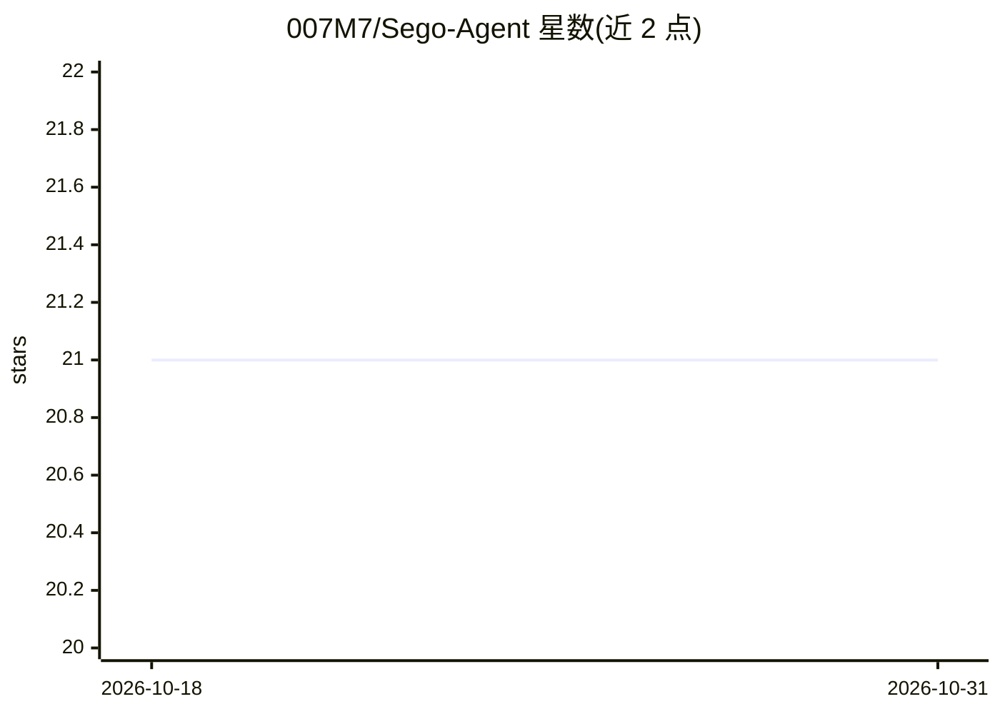

# 007M7/Sego-Agent

⭐ 21 · Rust · MIT · 推送 2026-09-21 · [GitHub](https://github.com/007M7/Sego-Agent) · 个人维护 · 中文 README

**AI 生成代码的工程审查层：证据化评审与验收留痕**

Rust 编写的本地 CLI（九 crate 工作区），在 Claude Code、Codex、Cursor 等 AI 编码工具生成代码之后运行：对限定范围的 diff 执行模型驱动的受限评审，再经确定性的 Evidence Gate 校验每条 finding 引用的位置是否真实存在于被审查变更中，输出带 severity 与 evidence_status 的结构化结果，持久化到 .sego/reviews/（JSON/Markdown/append-only index）。支持 diff_hash 绑定防止审查与提交错位，零 finding 不等于验收通过。明确声明为模型评审而非穷尽静态分析，集成层为实验性 PoC。

## 筛选速览

| 维度 | 判定 | 备注 |
|---|---|---|
| AI 角色 | `ai-ecosystem` | LLM/agent 周边工具 |
| 许可风险 | `permissive` | MIT |
| 部署形态 | `desktop` | 安装包/桌面程序 |
| 模型依赖 | — | README 未给出锁定关系 |
| 硬件要求 | — | 无带数字的原话,不猜 |
| 安装摩擦 | `medium` | 含编译或系统依赖之一 |
| 成熟度 | `idea` | |

## 能力要点

- Evidence Gate 确定性校验 finding 引用位置，保留 unverified 缺口
- diff_hash 绑定评审与验证指向同一代码变更
- 三级解析策略，解析失败显式标记而非静默记 0 findings
- 评审产物持久化到 .sego/reviews/，含 JSON Schema 公开契约

## 适用场景

- AI 编码工具产出代码后做独立二次评审
- 为代码验收决策留存可复查的证据记录
- 在 agent 工作流中定位和消费历史评审结果

## 场景标签

`代码审查` · 领域:编码与开发

## 证据(README 行号)

> L20: Sego is not another AI coding tool, nor an IDE. It works **after** AI coding tools (Claude Code, Codex, Cursor, etc
> L60: |**Review Engine**|diff collection → prompt construction → model review → parsing → evidence gate → persistence|`Re

## 星数曲线

2026-10-18 21 → 2026-10-31 21（+0）

---
*卡片 v1 · prompt 1.4 · 生成 2026-10-28 · 置信度 high · 依据 README sha `15dd8bc9ba39` · [字段定义](../../DATASET.md)*
