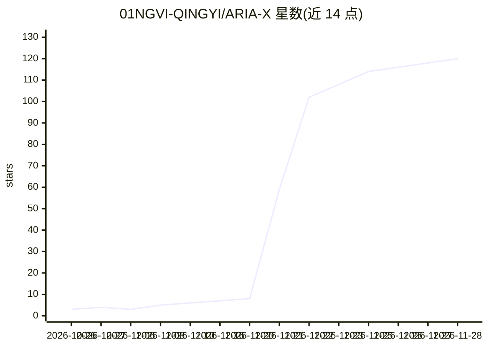

# 01NGVI-QINGYI/ARIA-X

⭐ 120 · Python · AGPL-3.0 · 推送 2026-11-25 · [GitHub](https://github.com/01NGVI-QINGYI/ARIA-X) · 个人维护 · 中文 README

**面向安全研究的本地自主推理 Agent，产出可核验证据报告**

将自主推理、受控工具执行与证据管理整合为可复盘的安全研究工作流，面向本地及隔离实验环境。融合 ARTEX、Cairn、PentAGI 三个项目的架构思想：Planner 生成意图、Worker 调用工具验证，Fact/Intent/Finding 黑板与 SQLite 状态图记录全过程，最终生成 Markdown/HTML/JSON 报告。基于 Python 标准库零依赖实现，支持离线运行与 Scope 白名单、审批门、四维预算等执行控制。

## 筛选速览

| 维度 | 判定 | 备注 |
|---|---|---|
| AI 角色 | `ai-native` | 本体是模型或模型工具 |
| 许可风险 | `viral` | AGPL-3.0 |
| 部署形态 | `self-host` | docker 或自建部署 |
| 模型依赖 | local-ok | 支持本地模型 |
| 硬件要求 | — | 无带数字的原话,不猜 |
| 安装摩擦 | `low` | 无编译、无系统依赖或容器化 |
| 成熟度 | — | 结构信号不足 |

## 能力要点

- Planner→Worker→Finding→Report 全流程，证据链持久化于 SQLite 状态图（15 表）
- Python 标准库零依赖，仅需 CPython 3.11+，支持离线演示（无需 API Key）
- 27 个内置工具，统一经 ToolRegistry 做 Scope 校验、审批门拦截与审计
- 原生支持 OpenAI 兼容接口（DeepSeek/vLLM/Ollama/OpenRouter）与 Anthropic

## 适用场景

- 在本机隔离靶场上验证配置缺陷并生成可复现证据报告
- 以 Scope 白名单和审批门约束 Agent 的目标探测行为
- 对安全研究过程进行状态持久化、审计与跨运行追踪

## 场景标签

`网络安全` · 领域:学习与行业

## 证据(README 行号)

> L22: **ARIA-X 将自主推理、受控工具执行与证据管理整合为一套可复盘的安全研究工作流。** 面向本地及隔离实验环境，基于 Python 标准库构建，支持离线运行，并把每一步探索记录为可追溯的状态与证据。
> L31: > Planner 负责生成研究意图，Worker 负责验证并收集证据；`Fact / Intent / Finding` 黑板与持久化图谱记录整个过程。`Scope`、执行预算、命令策略与审批门贯穿工具调用，最终形成可追溯的发现

## 星数曲线

2026-10-26 3 → 2026-11-28 120（+117）

---
*卡片 v1 · prompt 1.4 · 生成 2026-11-28 · 置信度 mid · 依据 README sha `74684a274cf0` · [字段定义](../../DATASET.md)*
