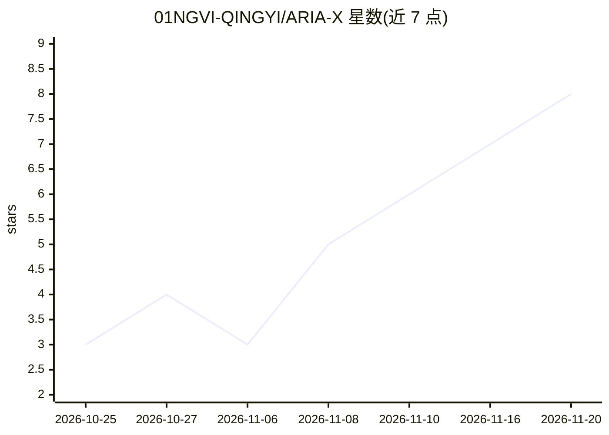

# 01NGVI-QINGYI/ARIA-X

⭐ 8 · Python · AGPL-3.0 · 推送 2026-11-10 · [GitHub](https://github.com/01NGVI-QINGYI/ARIA-X) · 个人维护 · 中文 README

**面向安全研究的本地状态空间推理 agent，输出可核验证据报告**

以 Python 标准库零依赖实现的自主调查 agent：Planner 生成研究意图，Worker 调用 27 个内置工具在 Scope 白名单内收集事实，全部过程写入 SQLite 状态图，最终生成 report.md/html 与 findings.json。内置审批门、命令策略、四维预算护栏与本地 Web 控制台。提供无需 API Key 的离线端到端演示。README 明确限定仅用于本地隔离实验环境，禁止对在线系统扫描或用于真实渗透测试。

## 筛选速览

| 维度 | 判定 | 备注 |
|---|---|---|
| AI 角色 | `ai-native` | 本体是模型或模型工具 |
| 许可风险 | `viral` | AGPL-3.0 |
| 部署形态 | `self-host` | docker 或自建部署 |
| 模型依赖 | local-ok | 支持本地模型 |
| 硬件要求 | — | 无带数字的原话,不猜 |
| 安装摩擦 | `low` | 无编译、无系统依赖或容器化 |
| 成熟度 | — | 结构信号不足 |

## 能力要点

- Fact/Intent/Finding 黑板与 15 表 SQLite 持久化状态图
- Scope 白名单、命令策略与分级审批门统一拦截工具调用
- 离线 demo 无需 API Key 即可跑通 Planner→Worker→Finding→Report
- 支持 OpenAI 兼容接口与 Anthropic，含 mock/scenario 确定性测试替身

## 适用场景

- 在隔离本机环境中做安全教学与原理性验证
- 学习状态空间搜索 agent 的工程实现与审计设计
- 对授权本地靶场运行可追溯证据链的调查任务

## 场景标签

`网络安全` `Agent 框架` · 领域:Agent 开发

## 证据(README 行号)

> L22: **ARIA-X 将自主推理、受控工具执行与证据管理整合为一套可复盘的安全研究工作流。** 面向本地及隔离实验环境，基于 Python 标准库构建，支持离线运行，并把每一步探索记录为可追溯的状态与证据。
> L71: - **离线端到端可验证**：运行 `./aria-x demo` 无需 API Key、无需联网，即可在本机 `127.0.0.1` 随机端口启动内置教学靶场，完整跑通 `Planner → Worker → Finding →
> L73: - **多模型无缝接入**：原生支持 OpenAI 兼容接口（DeepSeek、vLLM、Ollama、OpenRouter 等）与 Anthropic，同时提供 `mock` 与 `scenario` 两种确定性测试替身。

## 星数曲线

2026-10-25 3 → 2026-11-20 8（+5）

---
*卡片 v1 · prompt 1.4 · 生成 2026-11-20 · 置信度 mid · 依据 README sha `e332836ce2cc` · [字段定义](../../DATASET.md)*
