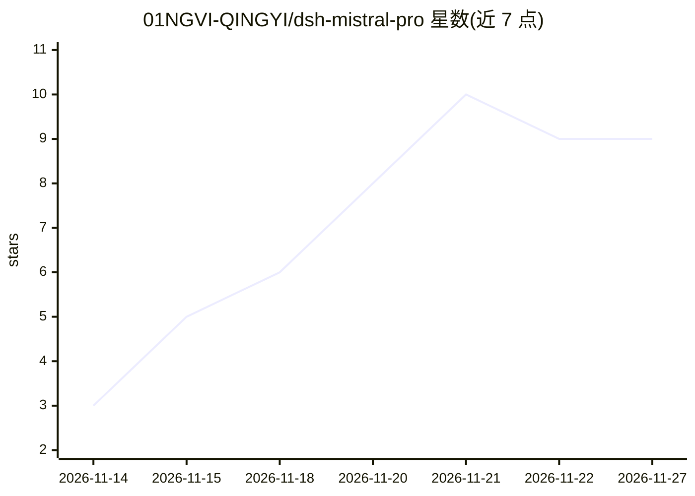

# 01NGVI-QINGYI/dsh-mistral-pro

⭐ 9 · JavaScript · MIT · 推送 2026-11-16 · [GitHub](https://github.com/01NGVI-QINGYI/dsh-mistral-pro) · 个人维护 · 中文 README

**在 DeepSeek Harness 中接入 Mistral 订阅的插件**

DSH（DeepSeek Harness）的第三方插件：将 Mistral 订阅（Vibe Pro / Team）接入 DSH，提供 mistral-pro 模型路由、多账号顺序调用与故障切换（401/403/429/额度耗尽时自动换号并冷却），以及输入框工具栏的额度面板（月度额度、预付余额、重置倒计时）。请求转换为 OpenAI 兼容格式发往 Mistral API；模型目录可按模型调整上下文窗口、输出上限与思考强度。要求宿主 DSH >= 0.2.1-rc.5，通过 npm pack 打包 tarball 或直接挂载目录安装。

## 筛选速览

| 维度 | 判定 | 备注 |
|---|---|---|
| AI 角色 | `ai-ecosystem` | LLM/agent 周边工具 |
| 许可风险 | `permissive` | MIT |
| 部署形态 | `None` |  |
| 模型依赖 | — | README 未给出锁定关系 |
| 硬件要求 | — | 无带数字的原话,不猜 |
| 安装摩擦 | `low` | 无编译、无系统依赖或容器化 |
| 成熟度 | — | 结构信号不足 |

## 能力要点

- 多账号按序调用，401/403/429 或额度耗尽时自动故障切换（流式输出开始前）
- 额度面板读取 api.mistral.ai 账单接口，可选管理站点 Cookie 兜底
- 内置 19 个模型目录，支持按模型调整上下文窗口与 reasoning_effort
- 提供 health/meta/models/usage 等只读调试路由

## 适用场景

- 在 DeepSeek Harness 中通过 Mistral 订阅额度调用模型
- 配置多个 Mistral 账号实现容灾切换
- 在输入框工具栏查看订阅额度使用比例与重置时间

## 场景标签

`模型网关` `编码 Agent` · 领域:Agent 开发

## 证据(README 行号)

> L3: 在 DeepSeek Harness 中接入 Mistral 订阅（Vibe Pro / Team），提供 `mistral-pro` 模型路由、多账号故障切换和输入框工具栏的额度面板。
> L88: `llm` 服务将对话交给插件适配器后，会转换为 OpenAI 兼容格式并 POST 到 `https://api.mistral.ai/v1/chat/completions`，逐行解析 SSE 流并转为 DSH 的 `Stre

## 星数曲线

2026-11-14 3 → 2026-11-27 9（+6）

---
*卡片 v1 · prompt 1.4 · 生成 2026-11-20 · 置信度 high · 依据 README sha `84217ed51b12` · [字段定义](../../DATASET.md)*
