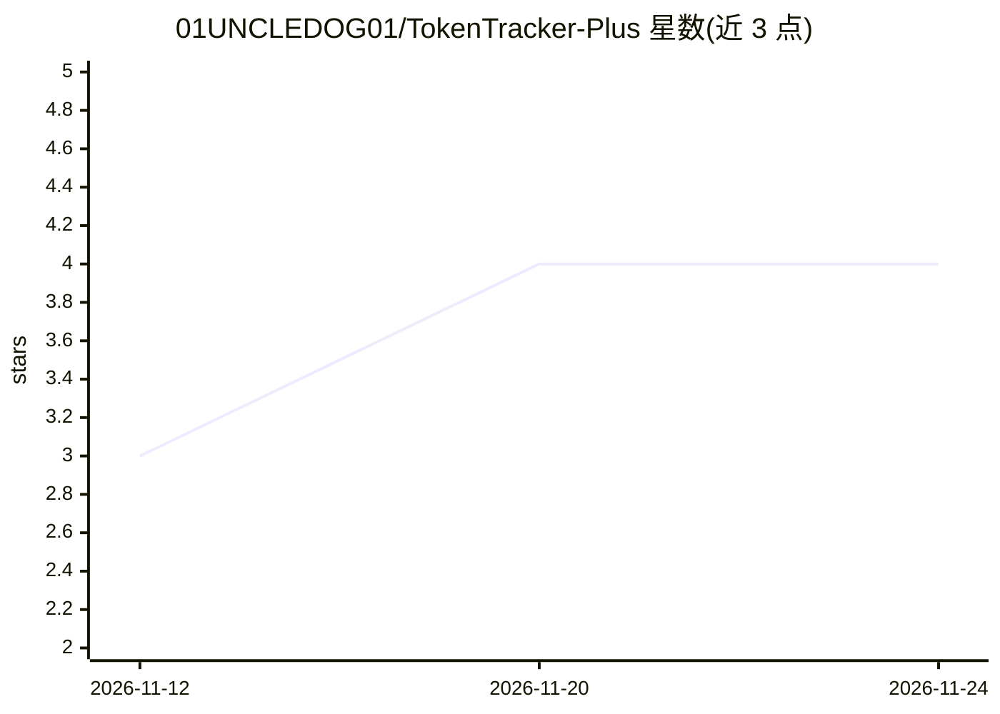

# 01UNCLEDOG01/TokenTracker-Plus

⭐ 4 · JavaScript · MIT · 推送 2026-11-23 · [GitHub](https://github.com/01UNCLEDOG01/TokenTracker-Plus) · 个人维护 · 中文 README

**给 AI 编码工具重度用户的本地 Token 用量追踪桌面端**

本地优先的桌面端 Token 用量追踪工具，自动识别并挂接本机已安装的 55 款 AI 编码工具与 IDE，通过读取本地日志、SQLite 数据库或写入 SessionEnd/notify hook 采集 token 用量，提供 Web Dashboard、Windows 托盘端与 macOS 菜单栏端，展示花费、生成速率（tok/s）、会话拓扑、8 阶热力图、35 家限额卡与 79 家服务商福利指南。100% 本地运行，无账号与 API Key 要求，MIT 许可，为上游 xiufengsun/TokenTracker 的深度重构 fork。

## 筛选速览

| 维度 | 判定 | 备注 |
|---|---|---|
| AI 角色 | `ai-ecosystem` | LLM/agent 周边工具 |
| 许可风险 | `permissive` | MIT |
| 部署形态 | `desktop` | 安装包/桌面程序 |
| 模型依赖 | — | README 未给出锁定关系 |
| 硬件要求 | — | 无带数字的原话,不猜 |
| 安装摩擦 | `medium` | 含编译或系统依赖之一 |
| 成熟度 | — | 结构信号不足 |

## 能力要点

- 自动挂接 55 款 AI 编码工具，读取本地日志/SQLite 采集用量
- 毫秒级 tok/s 生成速率捕获与思考 tokens 独立核算
- 8 阶热力图、65 枚离线成就、会话拓扑下钻
- Windows/macOS 安装包内置 Node 运行时，无需账号与 API Key

## 适用场景

- 汇总多款 AI 编码客户端的碎片化用量账本
- 排查高耗会话与子代理调用链路
- 追踪各服务商限额窗口与重置倒计时

## 场景标签

`LLM 可观测性` · 领域:评测与运维

## 证据(README 行号)

> L15: > 💡 **关于本仓库**：TT-plus 是基于原作者 xiufengsun/TokenTracker（MIT 许可）深度重构的单机与自托管增强版。核心目标是**100% 本地优先**、**真值计费**、**会话拓扑下钻**与*
> L119: 本仓库当前支持 **55 款 AI 编码工具**（以 `src/commands/init.js` 的 `SUPPORTED_PROVIDERS` 为准）：**47 款为 TT 原版支持**（上游共 47 款），**8 款为本 

## 星数曲线

2026-11-12 3 → 2026-11-24 4（+1）

---
*卡片 v1 · prompt 1.4 · 生成 2026-11-21 · 置信度 high · 依据 README sha `9b1fca353102` · [字段定义](../../DATASET.md)*
