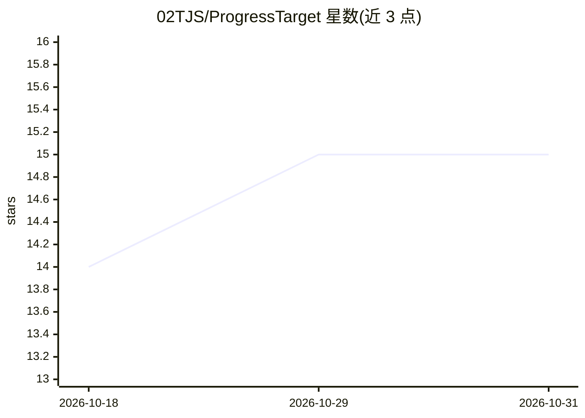

# 02TJS/ProgressTarget

⭐ 15 · JavaScript · MIT · 推送 2026-09-06 · [GitHub](https://github.com/02TJS/ProgressTarget) · 个人维护 · 中文 README

**AI agent 任务的持久化计划与质量门插件（DSH/Codex）**

面向 DeepSeek Harness（DSH）与 Codex 两个宿主平台的独立安装插件：为每个会话建立持久化执行计划，包含质量度量、必需交付物、依赖分阶段任务、北京时间截止时间、资源快照、重试与受保护历史；先规划、经显式授权后再执行。DSH 版在 DSH Web 中提供进度页，Codex 版提供本任务作用域的本地浏览器面板。不含实验执行器或后台调度器。安装方式为 git clone 后以插件命令装入宿主。

## 筛选速览

| 维度 | 判定 | 备注 |
|---|---|---|
| AI 角色 | `ai-ecosystem` | LLM/agent 周边工具 |
| 许可风险 | `permissive` | MIT |
| 部署形态 | `None` |  |
| 模型依赖 | — | README 未给出锁定关系 |
| 硬件要求 | — | 无带数字的原话,不猜 |
| 安装摩擦 | `low` | 无编译、无系统依赖或容器化 |
| 成熟度 | — | 结构信号不足 |

## 能力要点

- 每个会话独立拥有持久化计划，先规划后显式授权执行
- 支持质量度量、必需交付物、依赖分阶段任务、截止时间、资源快照与重试
- DSH Web 进度页 + Codex 本地浏览器仪表盘两种进度视图
- 两插件相互独立安装，运行数据与依赖彼此分离

## 适用场景

- 在 DSH 或 Codex 会话中为任务建立可追溯的分阶段执行计划
- 在仪表盘中查看 AI agent 任务进度与质量门达成情况
- 为 AI agent 任务记录资源快照与受保护历史

## 场景标签

 · 领域:AI agent 工具/插件

## 证据(README 行号)

> L5: Persistent plans, measurable quality gates, and visible progress for AI agent tasks. Each conversation owns its plan
> L7: This repository contains two independently installable plugins:
> L11: |DeepSeek Harness (DSH)|2.0.1|Progress tab in DSH Web|DSH plugin|

## 星数曲线

2026-10-18 14 → 2026-10-31 15（+1）

---
*卡片 v1 · prompt 1.4 · 生成 2026-10-31 · 置信度 high · 依据 README sha `26b287cb2e71` · [字段定义](../../DATASET.md)*
