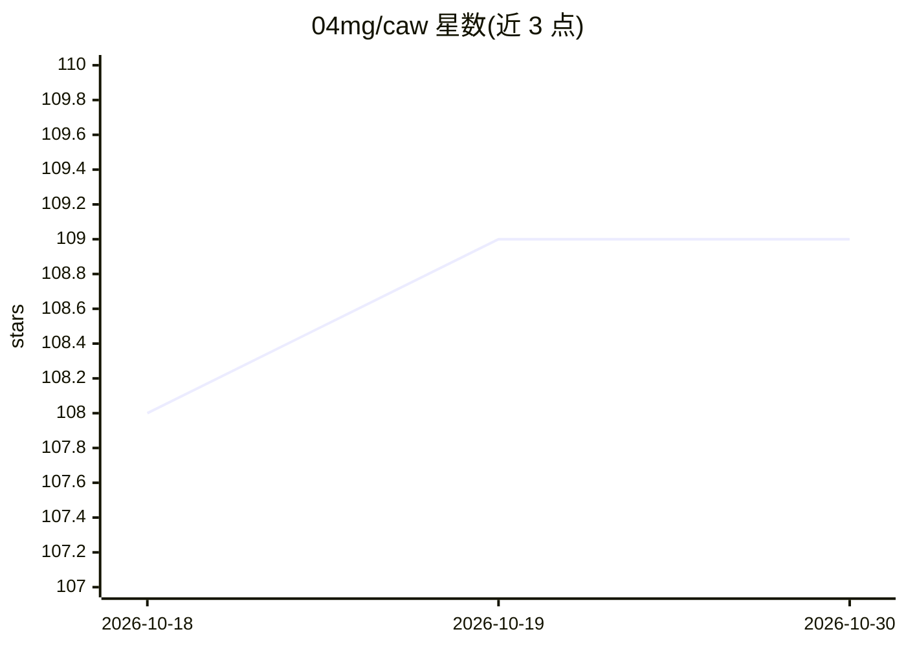

# 04mg/caw

⭐ 109 · TypeScript · MIT · 推送 2026-09-06 · [GitHub](https://github.com/04mg/caw) · [官网](https://caw.rocks) · 个人维护

**在浏览器中并排运行与管理多个 AI 编程 Agent 的 Web 界面**

面向使用命令行编程 Agent 的开发者的 Web 工具：自动检测本机已安装的 Claude Code、Codex CLI、GitHub Copilot、OpenCode 等 10 种 Agent，为每个 Agent 在浏览器中开一个终端窗格并排运行。通过读取各 Agent 的 transcript 在看板上实时展示 Working/Needs Input/Idle 状态；为每个 Agent 自动创建隔离的 git worktree 与分支以支持并行任务，并在需要输入或完成时推送通知到桌面或手机。另提供多家供应商的用量配额监控、浏览器语音输入与终端宠物等。

## 筛选速览

| 维度 | 判定 | 备注 |
|---|---|---|
| AI 角色 | `ai-ecosystem` | LLM/agent 周边工具 |
| 许可风险 | `permissive` | MIT |
| 部署形态 | `None` |  |
| 模型依赖 | — | README 未给出锁定关系 |
| 硬件要求 | — | 无带数字的原话,不猜 |
| 安装摩擦 | `low` | 无编译、无系统依赖或容器化 |
| 成熟度 | — | 结构信号不足 |

## 能力要点

- 自动检测 10 种 CLI 编程 Agent 并在浏览器终端窗格并排运行
- 基于 transcript 的实时状态看板（Working/Needs Input/Idle）
- 为每个 Agent 自动创建与清理隔离 git worktree，支持并行无文件冲突
- 支持 Claude/Codex/Copilot/Ollama/OpenRouter 等 9 家的实时配额监控
- 推送通知到桌面浏览器或手机

## 适用场景

- 同时并行运行多个 AI 编程 Agent 处理不同任务
- 离开电脑时通过推送通知获知 Agent 需要输入或已完成
- 查看各 Agent 供应商的用量限额与重置时间

## 场景标签

`编码 Agent` · 领域:编码与开发

## 证据(README 行号)

> L9:  Web interface for AI agents.
> L17: Launch Claude Code, Codex CLI, GitHub Copilot, OpenCode, Antigravity, Command Code, Pi, Oh My Pi, or Hermes side-by
> L59: Caw launches any CLI coding agent that runs in a terminal. These are detected on your machine and supported out of 

## 星数曲线

2026-10-18 108 → 2026-10-30 109（+1）

---
*卡片 v1 · prompt 1.4 · 生成 2026-10-23 · 置信度 high · 依据 README sha `a7bdeabdc774` · [字段定义](../../DATASET.md)*
