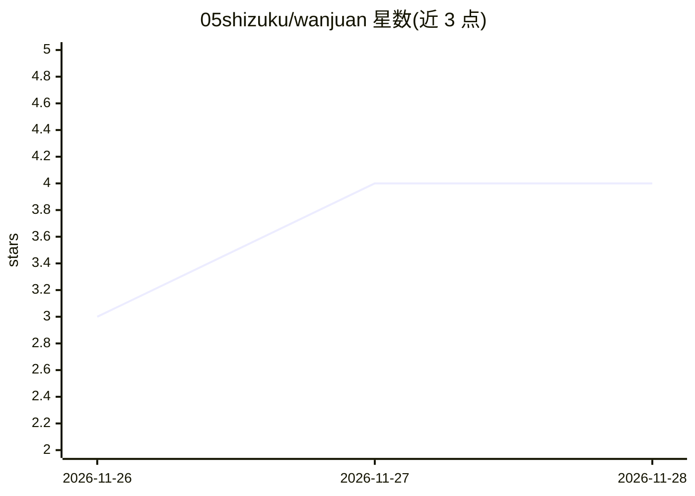

# 05shizuku/wanjuan

⭐ 4 · JavaScript · MIT · 推送 2026-11-27 · [GitHub](https://github.com/05shizuku/wanjuan) · [官网](https://github.com/05shizuku/wanjuan/releases) · 个人维护 · 中文 README

**为 DSH 宿主设计的上下文压缩内核：折叠长对话控制窗口**

万卷是一个面向 LLM 宿主（如 DeepSeek Harness）的上下文压缩内核，纯 Node.js ESM 实现，零第三方依赖。机制包括：事件溯源账本（append-only JSONL）、两段式水位引擎（80% 提醒/95% 自动折叠）、桥接宿主 compactRegion 接口、mut 事件吸收历史突变、崩溃锁自愈、按会话隔离账本目录、k̂ EMA 校准的 token 估算。README 明示多项局限：归因分类未完成、k̂ 冷启动存在双向偏差、宿主 compaction 异步契约的上游问题。通过 git clone 后软链挂入 DSH profile 使用。

## 筛选速览

| 维度 | 判定 | 备注 |
|---|---|---|
| AI 角色 | `ai-ecosystem` | LLM/agent 周边工具 |
| 许可风险 | `permissive` | MIT |
| 部署形态 | `None` |  |
| 模型依赖 | — | README 未给出锁定关系 |
| 硬件要求 | — | 无带数字的原话,不猜 |
| 安装摩擦 | `low` | 无编译、无系统依赖或容器化 |
| 成熟度 | — | 结构信号不足 |

## 能力要点

- 事件溯源账本：msg/mut/fold/evict/unfold/promote，断电坏行隔离
- 桥接宿主 compactRegion：账本消息到真实日志区间的映射
- 多会话隔离与 245 个自动化测试（node --test）
- 五个 wj_* 工具：折叠/补桥/恢复/检索/报告

## 适用场景

- 长对话场景下控制上下文窗口与缓存失效
- 为 DSH 宿主会话提供折叠后的检索与原文恢复
- 审计宿主压缩与账本折叠的错位（补桥）

## 场景标签

`Agent 记忆` · 领域:Agent 开发

## 证据(README 行号)

> L7: **万卷** 是一个为 LLM 宿主（如 DeepSeek Harness）设计的**上下文压缩内核**。纯原生 Node.js ESM（>= 20），零第三方依赖，以事件溯源（Event Sourcing）与「前缀纪律」为根基，解
> L50: 唯一合法入口是 `ctx.compaction.compactRegion(startSeq, endSeq, agent)`——成功后真实日志区间替换成一个摘要节点，模型可见、缓存责任归宿主。万卷在账本里记录事件 `seq`（S

## 星数曲线

2026-11-26 3 → 2026-11-28 4（+1）

---
*卡片 v1 · prompt 1.4 · 生成 2026-11-27 · 置信度 high · 依据 README sha `cae63ca652ab` · [字段定义](../../DATASET.md)*
