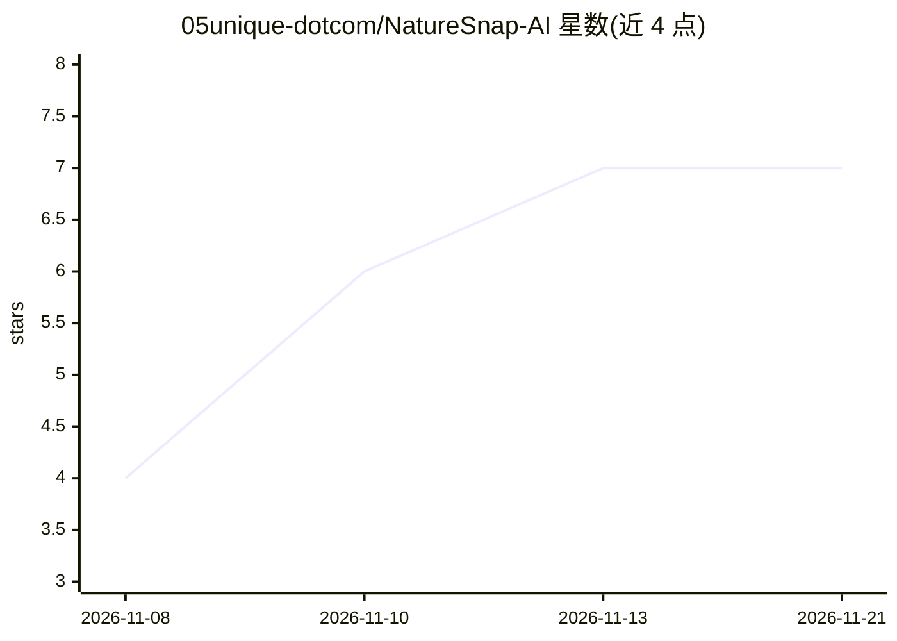

# 05unique-dotcom/NatureSnap-AI

⭐ 7 · HTML · MIT · 推送 2026-11-07 · [GitHub](https://github.com/05unique-dotcom/NatureSnap-AI) · [官网](https://naturesnap-ai.onrender.com/) · 个人维护

**上传自然照片，AI 生成物种识别与户外报告的 Web 应用**

基于 Node.js/Express 的 Web 应用：用户上传植物、花卉、鸟类或动物照片，后端经 Multer 接收并校验上传限制，将图片转为 data URL 发送到 Groq 的视觉模型（qwen/qwen3.8-27b），返回含可能名称、三条事实和一项户外活动的简短报告。前端为浏览器原生 HTML/CSS/JS，支持桌面与移动端。需自行配置 Groq API key，README 提醒 AI 识别仅为建议、需核实植物学信息。

## 筛选速览

| 维度 | 判定 | 备注 |
|---|---|---|
| AI 角色 | `ai-native` | 本体是模型或模型工具 |
| 许可风险 | `permissive` | MIT |
| 部署形态 | `library` | 以包/库形式分发 |
| 模型依赖 | locked-api |  |
| 硬件要求 | — | 无带数字的原话,不猜 |
| 安装摩擦 | `low` | 无编译、无系统依赖或容器化 |
| 成熟度 | — | 结构信号不足 |

## 能力要点

- 上传图片经 Groq 视觉模型生成物种识别报告
- 报告含通用名/学名、三条事实与一项户外活动建议
- 提供 Render 在线演示与 REST 接口 POST /api/analyze
- 上传大小限制与 API key 环境变量管理

## 适用场景

- 户外遇到不认识的植物花卉，拍照获取识别建议
- 带孩子做自然观察，生成趣味学习报告
- 自建一个图片识别演示应用参考学习

## 场景标签

`目标检测` · 领域:感知与多模态

## 证据(README 行号)

> L9: Upload a nature photo and get a short, AI-generated report with an identification, facts, and an outdoor activity.
> L14: - **AI-powered analysis:** Send the image to the Groq API for a generated report.
> L23: - **AI integration:** Groq chat completions API with `qwen/qwen3.8-27b`

## 星数曲线

2026-11-08 4 → 2026-11-21 7（+3）

---
*卡片 v1 · prompt 1.4 · 生成 2026-11-20 · 置信度 high · 依据 README sha `6db8c4c088dc` · [字段定义](../../DATASET.md)*
