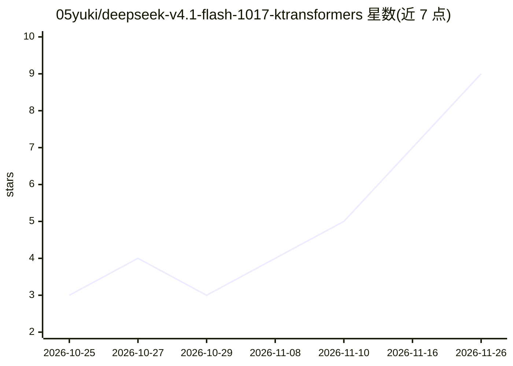

# 05yuki/deepseek-v4.1-flash-1017-ktransformers

⭐ 9 · Python · Apache-2.0 · 推送 2026-11-15 · [GitHub](https://github.com/05yuki/deepseek-v4.1-flash-1017-ktransformers) · 个人维护

**单机部署 DeepSeek-V4.1-Flash-1017 的 CPU/GPU 混合推理脚本集**

为在单台机器上运行 DeepSeek-V4.1-Flash-1017 提供完整部署方案：针对 SGLang 与 KTransformers 两个上游公开 commit 的补丁、一键 setup.sh 构建脚本、读取所在机器配置的启动器，以及测速与验收测试脚本（tools/check.sh、tools/qualify.sh）。机制上 384 个路由专家经 kt-kernel 在 CPU 上以 MXFP4 运行，注意力与 prefill 走 GPU 上的 SGLang，对外暴露 OpenAI 兼容 API。硬件门槛高：MXFP4 检查点需 512 GB 内存或单路 256 GB，另有 64 GB 内存 + GGUF 包的低配路径。以 Apache-2.0 许可发布。

## 筛选速览

| 维度 | 判定 | 备注 |
|---|---|---|
| AI 角色 | `ai-ecosystem` | LLM/agent 周边工具 |
| 许可风险 | `permissive` | Apache-2.0 |
| 部署形态 | `None` |  |
| 模型依赖 | locked-api |  |
| 硬件要求 | — | 无带数字的原话,不猜 |
| 安装摩擦 | `medium` | 含编译或系统依赖之一 |
| 成熟度 | — | 结构信号不足 |

## 能力要点

- 针对固定上游 commit 的补丁集，每个 tag 锁定版本并重新测量
- setup.sh/serve.sh/run.sh 一键构建、下载检查点并启动服务
- 按机器内存分三档路径：512 GB / 单路 256 GB / 64 GB + GGUF 包
- tools/qualify.sh 端到端验收并生成 Markdown 报告

## 适用场景

- 在单台大内存服务器上本地部署运行 DeepSeek-V4.1-Flash-1017
- 用 GGUF 量化包在 64 GB 内存加 8 GB 显卡的机器上运行该模型
- 复现并提交不同 CPU/GPU 组合的运行报告

## 场景标签

`推理引擎` · 领域:训练与推理

## 证据(README 行号)

> L1: # DeepSeek-V4.1-Flash-1017 on SGLang + KTransformers (CPU/GPU hybrid inference)
> L18: This repository is everything needed: patches against two public upstream commits, a setup
> L63: The server speaks SGLang's OpenAI-compatible API on `127.0.0.1:8080`.

## 星数曲线

2026-10-25 3 → 2026-11-26 9（+6）

---
*卡片 v1 · prompt 1.4 · 生成 2026-11-20 · 置信度 high · 依据 README sha `da9537da6077` · [字段定义](../../DATASET.md)*
