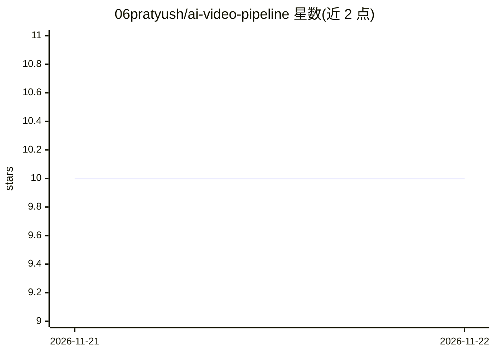

# 06pratyush/ai-video-pipeline

⭐ 10 · Python · MIT · 推送 2026-11-10 · [GitHub](https://github.com/06pratyush/ai-video-pipeline) · [官网](https://06pratyush.github.io/ai-video-pipeline/) · 个人维护

**本地 GPU 文本转视频生成器：脚本一键生成成片 MP4**

面向自有 NVIDIA GPU 用户的本地视频生成应用：粘贴文字脚本，选风格预设（Skill），经八阶段流水线产出带旁白、配乐、字幕与调色的 MP4。机制上由 ComfyUI 运行 Wan2.1 生成视频片段，Ollama 上的 Gemma 3/4B 改写脚本并生成场景提示词，Kokoro TTS 合成旁白，faster-whisper 生成字幕，MusicGen 配乐，FFmpeg 合成。提供 Electron 桌面安装包（Win/Linux/macOS），支持模板、批量渲染与 VRAM 自动降级；首次启动约需下载 20 GB 模型，之后离线运行。AMD GPU 暂不支持。

## 筛选速览

| 维度 | 判定 | 备注 |
|---|---|---|
| AI 角色 | `ai-native` | 本体是模型或模型工具 |
| 许可风险 | `permissive` | MIT |
| 部署形态 | `desktop` | 安装包/桌面程序 |
| 模型依赖 | local-ok | 支持本地模型 |
| 硬件要求 | `gpu-8g` | |
| 安装摩擦 | `medium` | 含编译或系统依赖之一 |
| 成熟度 | — | 结构信号不足 |

## 能力要点

- Wan2.1 + ComfyUI 本地视频生成，8 阶段流水线
- Ollama 上的 Gemma 3/4B 生成场景提示词
- VRAM 智能路由：显存满时自动降级到小模型
- 7 个内置风格 Skill 与模板/批量/版本历史功能

## 适用场景

- 本地离线生成 YouTube 解说或教程视频
- 为短视频平台批量渲染竖屏内容
- 无云服务依赖的产品演示视频制作

## 场景标签

`视频生成` `语音合成` `语音识别` · 领域:内容生成

## 证据(README 行号)

> L30: **AI Video Studio is a free, open-source, local AI video generator for Windows, Linux and macOS.**
> L31: You paste a text script, pick a style preset, and it produces a finished MP4 — narrated, scored,
> L37: Every stage is local: Wan2.1 renders the video through

## 星数曲线

2026-11-21 10 → 2026-11-22 10（+0）

---
*卡片 v1 · prompt 1.4 · 生成 2026-11-21 · 置信度 mid · 依据 README sha `e14f0cb8b47d` · [字段定义](../../DATASET.md)*
