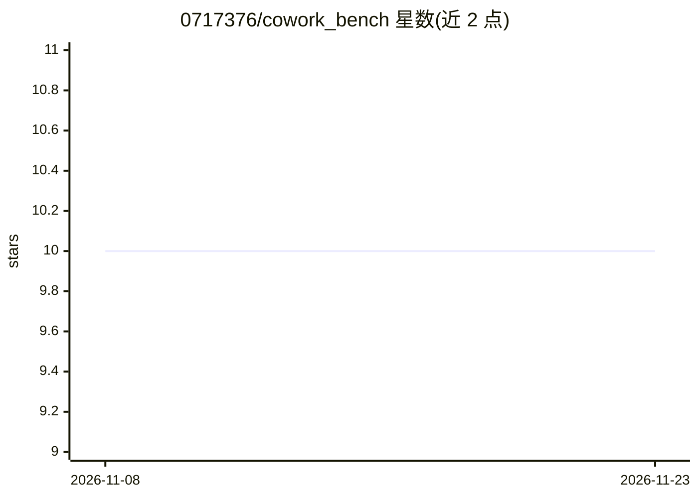

# 0717376/cowork_bench

⭐ 10 · Python · Apache-2.0 · 推送 2026-08-08 · [GitHub](https://github.com/0717376/cowork_bench) · 个人维护

**俄语多工具 LLM agent 基准：496 个 MCP 端到端任务本地评测**

基于 Toolathlon 构建的 agent 基准：496 个端到端任务模拟办公流程——从 mock 数据库取数、生成 Excel/Word/PPTX、排日历、发邮件，通过约 120 个 MCP 服务器执行。评测完全确定性：程序化检查加 SQL 副作用校验，不用 LLM-as-judge；整个评测在本地 Docker Compose 内运行，评估阶段零外部 API 调用。任务描述与系统提示均为俄语，附带 CAMEL 与 Strands 两个内置 runner，并支持自定义 runner 与基准数据扩展。

## 筛选速览

| 维度 | 判定 | 备注 |
|---|---|---|
| AI 角色 | `ai-ecosystem` | LLM/agent 周边工具 |
| 许可风险 | `permissive` | Apache-2.0 |
| 部署形态 | `self-host` | docker 或自建部署 |
| 模型依赖 | — | README 未给出锁定关系 |
| 硬件要求 | — | 无带数字的原话,不猜 |
| 安装摩擦 | `low` | 无编译、无系统依赖或容器化 |
| 成熟度 | — | 结构信号不足 |

## 能力要点

- 496 个端到端任务，每任务约 120 个可见 MCP 工具
- 确定性评测：程序化检查 + SQL 副作用校验，无 LLM-as-judge
- 单 Docker Compose 本地运行，评估阶段零外部 API 调用
- 任务与提示俄语本地化，附俄罗斯域数据（铁路、1C HR 等）

## 适用场景

- 在真实办公工作流任务上评测自研 agent 框架
- 用 pass@1 结果横向对比不同 LLM 的工具使用能力
- 接入自己的 runner 跑同一任务池做回归评测

## 场景标签

`模型评测` · 领域:评测与运维

## 证据(README 行号)

> L5: **EN:** Cowork Bench is a multi-tool agent benchmark: **496 end-to-end tasks** that mirror real office workflows — p
> L21: - **CAMEL** (`main.py`) — дефолт: единый проход агент+оценка, минимальная обвязка.
> L31: Ключ и эндпоинт берутся из `MODEL_API_KEY` / `MODEL_API_URL`. Допустимые значения `MODEL_PROVIDER`: `openai`, `anth

## 星数曲线

2026-11-08 10 → 2026-11-23 10（+0）

---
*卡片 v1 · prompt 1.4 · 生成 2026-11-20 · 置信度 high · 依据 README sha `6d13d36422be` · [字段定义](../../DATASET.md)*
