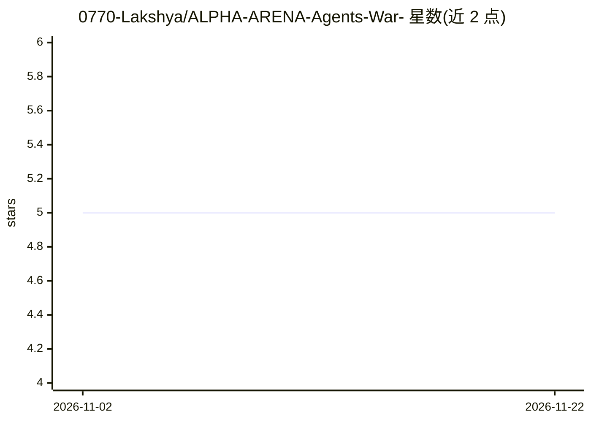

# 0770-Lakshya/ALPHA-ARENA-Agents-War-

⭐ 5 · Python · 推送 2026-11-01 · [GitHub](https://github.com/0770-Lakshya/ALPHA-ARENA-Agents-War-) · 组织维护

**交易 agent 竞赛入门套件：在 15 年印度股市数据上构建策略**

IIT Bhilai Meraz 7.0 黑客松的入门套件，提供 12 只匿名化印度股票 15 年日线数据（train.csv）、模拟器 engine.py、策略模板 strategy.py 与对比脚本 compare.py。参赛者在限定 10 年训练窗口内训练交易 agent，每日输出仓位权重，随后在未公开的 secret 期间回测评分，指标含净收益、夏普、最大回撤、泛化性等，规则限制仅用 numpy/pandas/scikit-learn、禁联网与硬编码价格。可经 Google Colab 或本地 clone 运行。

## 筛选速览

| 维度 | 判定 | 备注 |
|---|---|---|
| AI 角色 | `ai-knowledge` | 知识聚合/清单类 |
| 许可风险 | `none` | — |
| 部署形态 | `library` | 以包/库形式分发 |
| 模型依赖 | — | README 未给出锁定关系 |
| 硬件要求 | — | 无带数字的原话,不猜 |
| 安装摩擦 | `low` | 无编译、无系统依赖或容器化 |
| 成熟度 | — | 结构信号不足 |

## 能力要点

- 15 年、12 只匿名化股票的日线训练数据与隐藏 secret 期回测
- engine.py 统一模拟器评分，compare.py 对比多个 decide_xxx 与训练窗口
- 规则约束：训练窗口 ≤10 年、权重 |w|≤1、0.1% 交易成本、禁联网

## 适用场景

- 参加 Meraz 7.0 黑客松并提交 strategy.py 参赛
- 在 Colab 中快速跑通 starter.ipynb 学习量化回测流程
- 用 compare.py windows 检验策略在不同训练窗口下的泛化性

## 场景标签

`金融量化` · 领域:学习与行业

## 证据(README 行号)

> L3: You get 15 years of daily prices for 12 Indian stocks. Build a trading agent that decides,
> L16: |`strategy.py`|**Your agent** (we run this one). `python strategy.py` trains it and prints its performance metrics.
> L52: 2. Submit `strategy.py` using only python, numpy, pandas and scikit-learn. No internet or file reading inside it.

## 星数曲线

2026-11-02 5 → 2026-11-22 5（+0）

---
*卡片 v1 · prompt 1.4 · 生成 2026-11-21 · 置信度 high · 依据 README sha `5a7cc917419c` · [字段定义](../../DATASET.md)*
