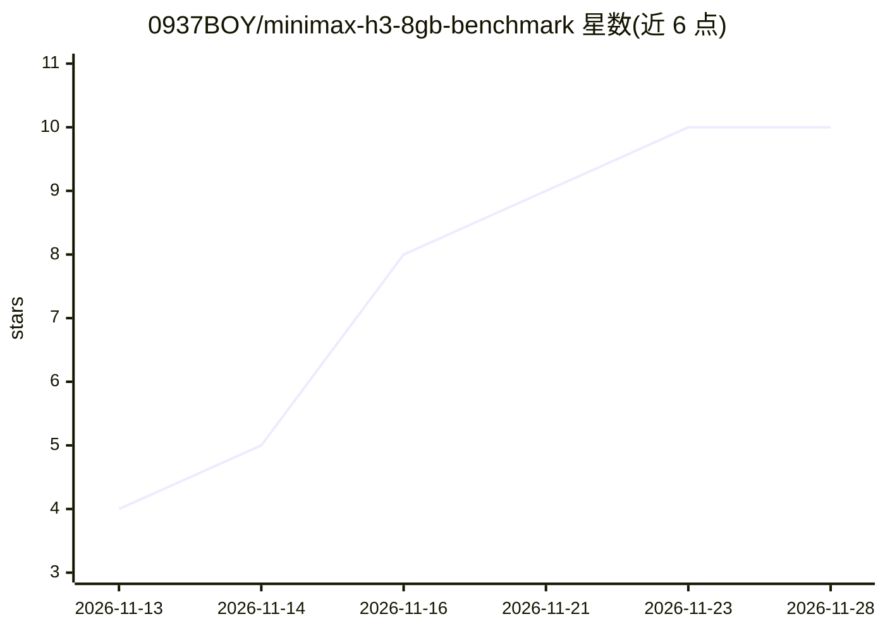

# 0937BOY/minimax-h3-8gb-benchmark

⭐ 10 · Python · NOASSERTION · 推送 2026-11-11 · [GitHub](https://github.com/0937BOY/minimax-h3-8gb-benchmark) · 个人维护 · 中文 README

**8GB 显存跑 MiniMax-H3 视频生成的基准测试报告与工作流**

记录在 RTX 3050 8GB 笔记本 GPU 上运行 MiniMax-H3 Ref2VA（INT8 剪枝 + 4 步 Turbo LoRA）的端到端基准数据：三个分辨率预设各测 4–6 次，给出总耗时、采样时间、显存峰值等指标，并总结三条发现（显存峰值与分辨率无关、长连续运行因主机内存耗尽而降速、分辨率切换触发约 50 秒模型重载）。仓库附 23 节点的极简 ComfyUI 工作流、监控脚本与原始 CSV 数据，面向想在低显存显卡上复现或扩展测试的用户。

## 筛选速览

| 维度 | 判定 | 备注 |
|---|---|---|
| AI 角色 | `ai-knowledge` | 知识聚合/清单类 |
| 许可风险 | `none` | NOASSERTION |
| 部署形态 | `None` |  |
| 模型依赖 | — | README 未给出锁定关系 |
| 硬件要求 | `gpu-8g` | |
| 安装摩擦 | `medium` | 含编译或系统依赖之一 |
| 成熟度 | — | 结构信号不足 |

## 能力要点

- 0.5/0.6/0.7 MP 三档分辨率的耗时与显存峰值实测数据
- 发现显存峰值与分辨率无关、瓶颈在采样时间
- 23 节点极简 ComfyUI 工作流可复现结果
- tools/monitor.py 监控脚本供在其他显卡上自测

## 适用场景

- 在 8GB 显存显卡上寻找 MiniMax-H3 可用的分辨率档位
- 参考工作流在自己的硬件上搭建 H3 参考图生视频
- 按 README 方法对不同显卡做可对比的基准测试

## 场景标签

`视频生成` `模型评测` · 领域:评测与运维

## 证据(README 行号)

> L1: # MiniMax-H3 on 8 GB VRAM — Resolution Benchmark
> L7: Measured end-to-end generation times for **MiniMax-H3 Ref2VA** (pruned INT8 + 4-step Turbo LoRA) on an **RTX 3050 8 
> L101: 3. Load `workflow/minimax_h3_ref2v_8gb.json`.

## 星数曲线

2026-11-13 4 → 2026-11-28 10（+6）

---
*卡片 v1 · prompt 1.4 · 生成 2026-11-20 · 置信度 high · 依据 README sha `93c655b6ab64` · [字段定义](../../DATASET.md)*
