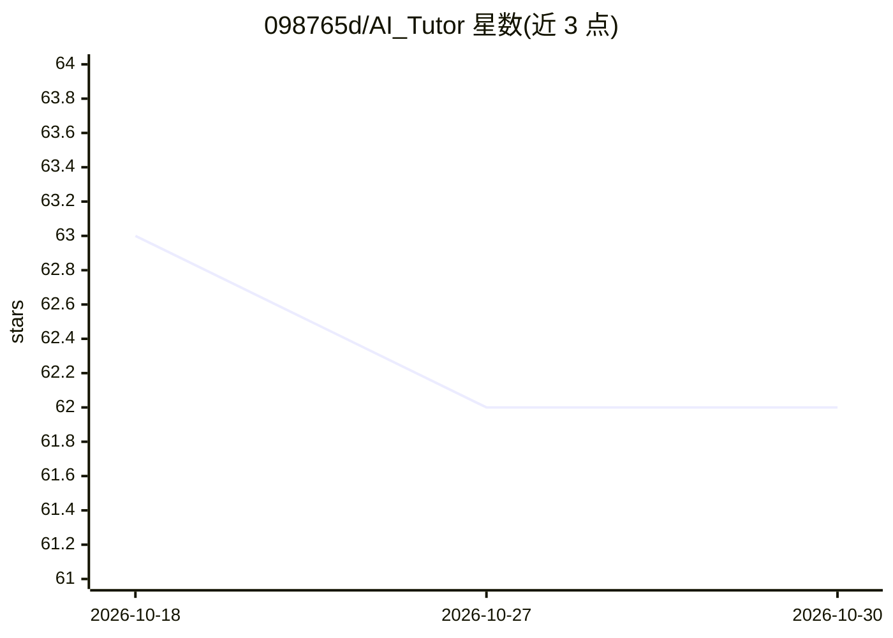

# 098765d/AI_Tutor

⭐ 62 · Python · MIT · 推送 2026-06-23 · [GitHub](https://github.com/098765d/AI_Tutor) · 组织维护

**基于知识图谱增强 RAG 的自适应课程 AI 辅导系统**

面向课程教学的问答辅导应用：将课程 PDF 切块后用 DeepSeek-V3 抽取实体关系三元组构建知识图谱，检索时匹配 KG 节点并遍历邻居扩展上下文，再合成辅导回答；支持 KG-RAG 与 Standard RAG 两种模式对比切换。对话历史按 MiniLM 嵌入相似度 ≥0.85 复用。以 Streamlit 网页应用形式运行，需配置 DeepSeek API key，DashScope 嵌入 key 为可选（缺省回退本地 MiniLM）。

## 筛选速览

| 维度 | 判定 | 备注 |
|---|---|---|
| AI 角色 | `ai-native` | 本体是模型或模型工具 |
| 许可风险 | `permissive` | MIT |
| 部署形态 | `library` | 以包/库形式分发 |
| 模型依赖 | locked-api |  |
| 硬件要求 | — | 无带数字的原话,不猜 |
| 安装摩擦 | `low` | 无编译、无系统依赖或容器化 |
| 成熟度 | — | 结构信号不足 |

## 能力要点

- KG 构建：PDF 切块后用 DeepSeek-V3 抽取 [Entity, Relation, Entity] 三元组
- 知识引导检索：嵌入查询、匹配 KG 节点并遍历邻居
- KG-RAG 与 Standard RAG 模式可切换对比
- 嵌入服务可选 DashScope 或回退本地 MiniLM

## 适用场景

- 为自己的课程 PDF 构建知识库并做辅导问答
- 对比知识图谱增强检索与标准 RAG 的回答效果
- 复用相似历史对话减少重复计算

## 场景标签

`知识图谱` `RAG` `文档问答` · 领域:知识与检索

## 证据(README 行号)

> L3: Adaptive AI tutoring system based on **Knowledge Graph-enhanced Retrieval-Augmented Generation (KG-RAG)**.
> L18: 1. **KG construction** — chunk course PDFs (~1,000 tokens), extract `[Entity, Relation, Entity]` triples with DeepS
> L44: streamlit run app.py

## 星数曲线

2026-10-18 63 → 2026-10-30 62（-1）

---
*卡片 v1 · prompt 1.4 · 生成 2026-10-24 · 置信度 mid · 依据 README sha `6ceeab2cbd4c` · [字段定义](../../DATASET.md)*
