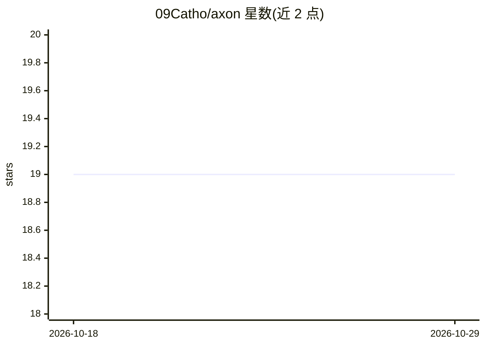

# 09Catho/axon

⭐ 19 · JavaScript · 推送 2026-05-19 · [GitHub](https://github.com/09Catho/axon) · 个人维护

**GPT-2 生成过程的实时 3D 可视化：逐 token 呈现 SAE 特征激活**

面向机制可解释性研究与教育的可视化工具：在 GPT-2 残差流第 8 层挂钩子，将每个 token 的隐状态经 Sparse Autoencoder 编码，取 top-K 激活特征经 WebSocket 流式推送到浏览器，以 Three.js 力导向图实时渲染；节点为 SAE 特征（含 Neuronpedia 标签），边为共激活关系。后端为 FastAPI + TransformerLens + SAELens，支持替换为其他 TransformerLens 模型与预训练 SAE（GPT-2 各规格、Pythia、Gemma-2 等）。需 Python 3.11，首次运行从 HuggingFace 下载 GPT-2 权重约 500 MB 与 SAE 约 200 MB；GPU 可选。

## 筛选速览

| 维度 | 判定 | 备注 |
|---|---|---|
| AI 角色 | `ai-ecosystem` | LLM/agent 周边工具 |
| 许可风险 | `permissive` | — |
| 部署形态 | `library` | 以包/库形式分发 |
| 模型依赖 | — | README 未给出锁定关系 |
| 硬件要求 | `cpu-ok` | |
| 安装摩擦 | `medium` | 含编译或系统依赖之一 |
| 成熟度 | — | 结构信号不足 |

## 能力要点

- 逐 token 的 SAE 特征激活实时 3D 力导向图可视化
- 支持替换为 TransformerLens 支持的模型与 SAELens 预训练 SAE（GPT-2/Pythia/Gemma-2 等）
- 特征节点带 Neuronpedia 人类可读标签与详情检查器
- 提供 WebSocket API、六项自动化基准检查与延迟对比数据

## 适用场景

- 研究/教学中直观观察语言模型内部概念激活
- 探索不同 prompt 触发的 SAE 特征与共激活结构
- 为可解释性演示或实验搭建本地可视化环境

## 场景标签

 · 领域:机器学习可解释性/可视化

## 证据(README 行号)

> L20: AXON hooks into GPT-2's residual stream at layer 8, runs each token's hidden state through a
> L313: Built for mechanistic interpretability research and education.

## 星数曲线

2026-10-18 19 → 2026-10-29 19（+0）

---
*卡片 v1 · prompt 1.4 · 生成 2026-10-29 · 置信度 mid · 依据 README sha `1a2fe822d406` · [字段定义](../../DATASET.md)*
