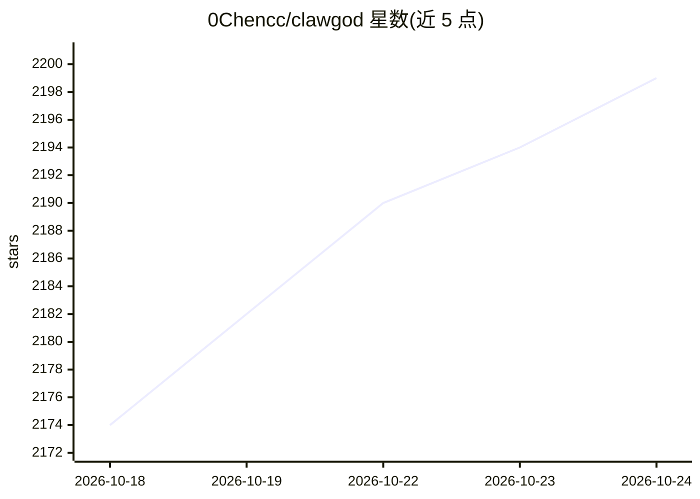

# 0Chencc/clawgod

⭐ 2,207 · JavaScript · GPL-3.0 · 推送 2026-10-24 · [GitHub](https://github.com/0Chencc/clawgod) · [官网](http://clawgod.0chen.cc) · 个人维护 · 中文 README

**Claude Code 官方二进制的运行时补丁：解锁隐藏功能与移除限制**

对官方 Claude Code 的 Bun 独立二进制做运行时打补丁的工具：每次 Claude Code 更新后在下次启动自动重新提取并重新打补丁。补丁覆盖功能解锁（隐藏命令、Agent Teams、Computer Use、Ultraplan 等）、限制移除（安全测试拒绝、URL 限制、破坏性操作确认等）、地理位置隐写中和、绿色主题与可靠性修复（Glob/Grep 恢复、渲染器 shim、第三方缓存修复）。通过 provider.json 可指向任意 Anthropic 兼容端点，并内置 OpenAI Chat Completions 协议代理；以 macOS/Linux/Windows 安装脚本分发，需预装 Claude Code、ripgrep、Node.js 与 Bun。

## 筛选速览

| 维度 | 判定 | 备注 |
|---|---|---|
| AI 角色 | `ai-ecosystem` | LLM/agent 周边工具 |
| 许可风险 | `viral` | GPL-3.0 |
| 部署形态 | `desktop` | 安装包/桌面程序 |
| 模型依赖 | — | README 未给出锁定关系 |
| 硬件要求 | — | 无带数字的原话,不猜 |
| 安装摩擦 | `low` | 无编译、无系统依赖或容器化 |
| 成熟度 | — | 结构信号不足 |

## 能力要点

- 对官方 Claude Code 二进制自动重打补丁，跨版本持续适配
- 解锁 24+ 隐藏命令、Agent Teams、Computer Use、Ultraplan/Ultrareview
- 移除系统提示中的多项限制并中和地理位置/代理隐写检测
- 内置环回代理，支持 Anthropic Messages 与 OpenAI Chat Completions 端点

## 适用场景

- 解锁 Claude Code 的隐藏命令与多智能体协作功能
- 让 Claude Code 通过第三方 Anthropic 兼容 API 使用
- 关闭部分补丁按需定制行为（patches.json 特性开关）

## 场景标签

`模型网关` · 领域:Agent 开发

## 证据(README 行号)

> L13: **This is NOT a third-party Claude Code client.** ClawGod is a runtime patch applied on top of the official Claude 
> L30: curl -fsSL https://github.com/0Chencc/clawgod/releases/latest/download/install.sh | bash
> L89: |**Third-Party Cache Fix**|Auto-disables `x-anthropic-billing-header` when `baseURL` is non-Anthropic. The header's

## 星数曲线

2026-10-18 2,174 → 2026-10-24 2,199（+25）

---
*卡片 v1 · prompt 1.4 · 生成 2026-10-21 · 置信度 mid · 依据 README sha `642a4f7efedf` · [字段定义](../../DATASET.md)*
