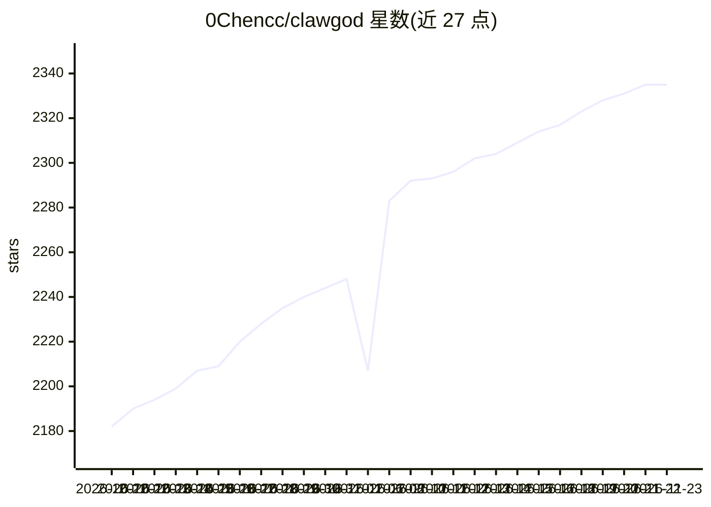

# 0Chencc/clawgod

⭐ 2,335 · JavaScript · GPL-3.0 · 推送 2026-11-22 · [GitHub](https://github.com/0Chencc/clawgod) · [官网](http://clawgod.0chen.cc) · 个人维护 · 中文 README

**官方 Claude Code 的运行时补丁：解锁功能、去除限制、增强隐私**

对官方 Claude Code 的 Bun 独立二进制打运行时补丁，启动时自动重新提取并重打补丁以适配新版本。功能上解锁隐藏命令、Agent Teams、Computer Use、auto-mode、第三方 API 门控等；去除安全拒绝指令、URL 限制、企业远程设置等约束；默认启用本地隐私防护，中和位置/代理探测信号并阻断 Git origin 与环境元数据收集。配置 provider.json 可指向任意 Anthropic 兼容端点，或通过内置回环代理接入 OpenAI Chat Completions 端点。非第三方客户端，需自备官方 Claude Code、Node.js ≥18 与 Bun。

## 筛选速览

| 维度 | 判定 | 备注 |
|---|---|---|
| AI 角色 | `ai-ecosystem` | LLM/agent 周边工具 |
| 许可风险 | `viral` | GPL-3.0 |
| 部署形态 | `desktop` | 安装包/桌面程序 |
| 模型依赖 | locked-api |  |
| 硬件要求 | — | 无带数字的原话,不猜 |
| 安装摩擦 | `low` | 无编译、无系统依赖或容器化 |
| 成熟度 | — | 结构信号不足 |

## 能力要点

- 自动跟随 Claude Code 版本更新重新打补丁
- 默认启用位置/代理信号中和与 Git origin 收集阻断
- 内置回环代理支持 OpenAI Chat Completions 端点
- 三级 Lean Settings 令牌优化，可随时切换

## 适用场景

- 让第三方 API 用户使用 auto-mode 等订阅门控功能
- 将 Claude Code 接入 Anthropic 兼容或 OpenAI 兼容网关
- 阻断客户端向模型请求附加的位置与环境元数据

## 场景标签

`编码 Agent` · 领域:编码与开发

## 证据(README 行号)

> L13: **This is NOT a third-party Claude Code client.** ClawGod is a runtime patch applied on top of the official Claude 
> L106: |**Third-Party Cache Fix**|Auto-disables `x-anthropic-billing-header` when `baseURL` is non-Anthropic. The header'

## 星数曲线

2026-10-21 2,182 → 2026-11-23 2,335（+153）

---
*卡片 v1 · prompt 1.4 · 生成 2026-11-23 · 置信度 mid · 依据 README sha `1080bdc204dc` · [字段定义](../../DATASET.md)*
