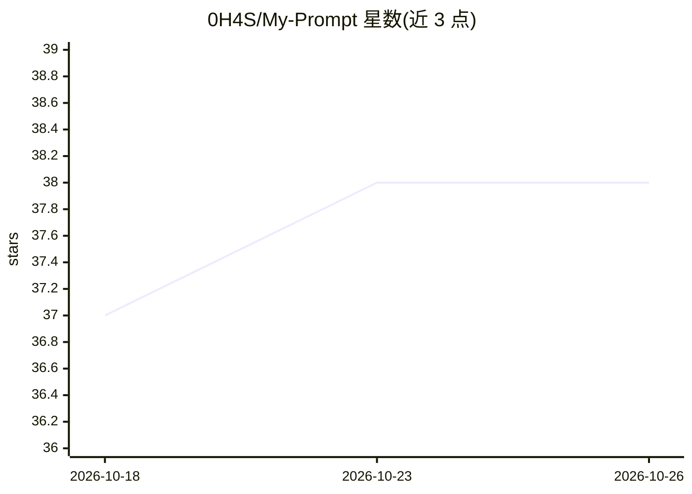

# 0H4S/My-Prompt

⭐ 38 · CSS · NOASSERTION · 推送 2026-09-22 · [GitHub](https://github.com/0H4S/My-Prompt) · [官网](https://greasyfork.org/scripts/549921) · 个人维护

**管理 AI 对话提示词的浏览器用户脚本**

运行于 Tampermonkey 的用户脚本，面向在网页端与 AI 对话的用户，提供动态提示词系统（支持变量与逻辑）、AI 优化草稿、自动提交、递归文件附加、带自动补全的编辑器、可筛选的历史浏览、自定义快捷键、主题界面、备份导出与 18 种语言翻译。通过 Greasy Fork 分发，采用 CC BY-NC-ND 4.0 许可。README 未给出具体安装步骤细节。

## 筛选速览

| 维度 | 判定 | 备注 |
|---|---|---|
| AI 角色 | `ai-enhanced` | 去掉 AI 部分产品仍成立 |
| 许可风险 | `none` | NOASSERTION |
| 部署形态 | `None` |  |
| 模型依赖 | — | README 未给出锁定关系 |
| 硬件要求 | — | 无带数字的原话,不猜 |
| 安装摩擦 | `low` | 无编译、无系统依赖或容器化 |
| 成熟度 | — | 结构信号不足 |

## 能力要点

- 动态 Prompt 系统，支持变量与复杂逻辑
- Enhance with AI 功能用 AI 优化提示词草稿
- 自动提交、递归文件附加与带自动补全的编辑器
- 备份导出系统与 18 种语言界面

## 适用场景

- 在 AI 网页对话中复用和管理常用提示词
- 用变量组织可复用的动态提示词模板
- 让 AI 帮我改写润色提示词草稿

## 场景标签

`提示工程` · 领域:Agent 开发

## 证据(README 行号)

> L9:  My Prompt is an advanced prompt management UserScript that transforms AI interaction into a professional control sy
> L10:  Workflow efficiency is ensured through automated submission, recursive file attachment, and a smart editor with au

## 星数曲线

2026-10-18 37 → 2026-10-26 38（+1）

---
*卡片 v1 · prompt 1.4 · 生成 2026-10-25 · 置信度 mid · 依据 README sha `24e54df1daf0` · [字段定义](../../DATASET.md)*
