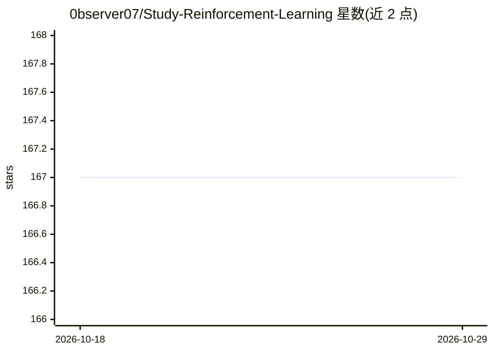

# 0bserver07/Study-Reinforcement-Learning

⭐ 167 · Python · NOASSERTION · 推送 2026-07-01 · [GitHub](https://github.com/0bserver07/Study-Reinforcement-Learning) · 个人维护

**强化学习与 LLM 对齐的个人学习笔记库：笔记、讲义、练习**

个人学习仓库（非库），收录三类内容：2017 年 Berkeley CS294 课程手写笔记与 Sutton & Barto 摘要；34 讲 AI 起草、未经逐篇人工审读的讲义系列（覆盖 MDP、策略梯度、RLHF、DPO、GRPO、RLVR、agentic RL、offline RL）；5 个带 pytest 测试且验证通过的编程练习（REINFORCE、Q-learning、值迭代、actor-critic、小型 GRPO 循环）。另含 arXiv 论文自动采集列表（约 430 篇摘要）、文献筛选与博客起草等辅助工具，以及精选演讲/书籍/课程链接。每篇文档顶部标注 hand-written/reviewed/unreviewed 状态。

## 筛选速览

| 维度 | 判定 | 备注 |
|---|---|---|
| AI 角色 | `ai-knowledge` | 知识聚合/清单类 |
| 许可风险 | `none` | NOASSERTION |
| 部署形态 | `None` |  |
| 模型依赖 | — | README 未给出锁定关系 |
| 硬件要求 | — | 无带数字的原话,不猜 |
| 安装摩擦 | `low` | 无编译、无系统依赖或容器化 |
| 成熟度 | `idea` | |

## 能力要点

- 34 讲系列覆盖 MDP 至 RLHF/DPO/GRPO/RLVR/agentic/offline RL
- 5 个带 pytest 测试、验证通过的编程练习
- 每篇文档标注 hand-written/reviewed/unreviewed 状态
- 约 430 篇 arXiv 摘要的论文列表与文献收集工具

## 适用场景

- 系统学习从经典 RL 到 LLM 对齐的强化学习内容
- 动手完成带测试与参考答案的 RL 编程练习
- 按 CURRICULUM.md 的顺序安排学习路径

## 场景标签

`教程课程` `强化学习` · 领域:学习与行业

## 证据(README 行号)

> L3: Notes, lectures, and exercises for learning reinforcement learning and how it's used to train language models, from 
> L18: - **`notes/lectures/`**: a 34-lecture series, MDPs through RLHF / DPO / GRPO / RLVR / agentic / offline. Editorial 
> L20: - **`reference/papers/`**: auto-collected paper lists from arXiv (~430 abstracts). Use as a search index, not a cur

## 星数曲线

2026-10-18 167 → 2026-10-29 167（+0）

---
*卡片 v1 · prompt 1.4 · 生成 2026-10-22 · 置信度 high · 依据 README sha `124428765a3e` · [字段定义](../../DATASET.md)*
