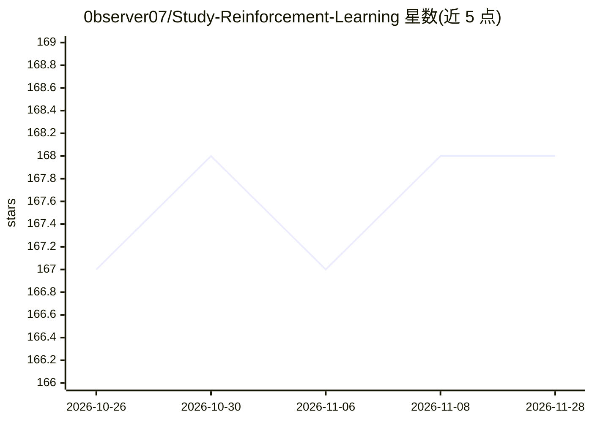

# 0bserver07/Study-Reinforcement-Learning

⭐ 168 · Python · NOASSERTION · 推送 2026-11-14 · [GitHub](https://github.com/0bserver07/Study-Reinforcement-Learning) · [官网](https://rl.yad.codes) · 个人维护

**RL 与 LLM 对齐的学习笔记与讲义集，面向学习者**

个人学习型仓库，非软件库：包含 2017 年伯克利 CS294 手写课堂笔记、Sutton & Barto 摘要、34 讲覆盖 RLHF/DPO/GRPO/RLVR/agentic/offline RL 的讲义草稿、9 个带 pytest 测试的编程练习，以及约 430 篇 arXiv 论文摘要索引。每个文档顶部标注 hand-written/reviewed/unreviewed 状态，讲义未经人工全文审阅，需与引用论文核对。配套网站 rl.yad.codes 提供浏览器内可观察学习过程的 Q-learning 演示。

## 筛选速览

| 维度 | 判定 | 备注 |
|---|---|---|
| AI 角色 | `ai-knowledge` | 知识聚合/清单类 |
| 许可风险 | `none` | NOASSERTION |
| 部署形态 | `None` |  |
| 模型依赖 | — | README 未给出锁定关系 |
| 硬件要求 | — | 无带数字的原话,不猜 |
| 安装摩擦 | `low` | 无编译、无系统依赖或容器化 |
| 成熟度 | — | 结构信号不足 |

## 能力要点

- 34 讲覆盖从 MDP 到 RLHF/DPO/GRPO/RLVR/agentic/offline 的讲义系列
- 9 个经测试验证的编程练习（value iteration 到 GRPO、RND）
- 文档标注 hand-written/reviewed/unreviewed 三级可信状态
- arXiv 自动采集的约 430 篇论文摘要索引

## 适用场景

- 从零开始系统学习强化学习基础与课程路线
- 动手实现 PPO、DPO、GRPO 等算法的练习
- 查阅 LLM 对齐（RLHF/RLVR）方向的论文入口

## 场景标签

`教程课程` `强化学习` · 领域:学习与行业

## 证据(README 行号)

> L3: Notes, lectures, and exercises for learning reinforcement learning and how it's used to train language models, from 
> L13: This is a personal study repo, not a library. It mixes notes a person wrote (some going back to a 2017 Berkeley cou

## 星数曲线

2026-10-26 167 → 2026-11-28 168（+1）

---
*卡片 v1 · prompt 1.4 · 生成 2026-11-27 · 置信度 high · 依据 README sha `34e0218b7098` · [字段定义](../../DATASET.md)*
