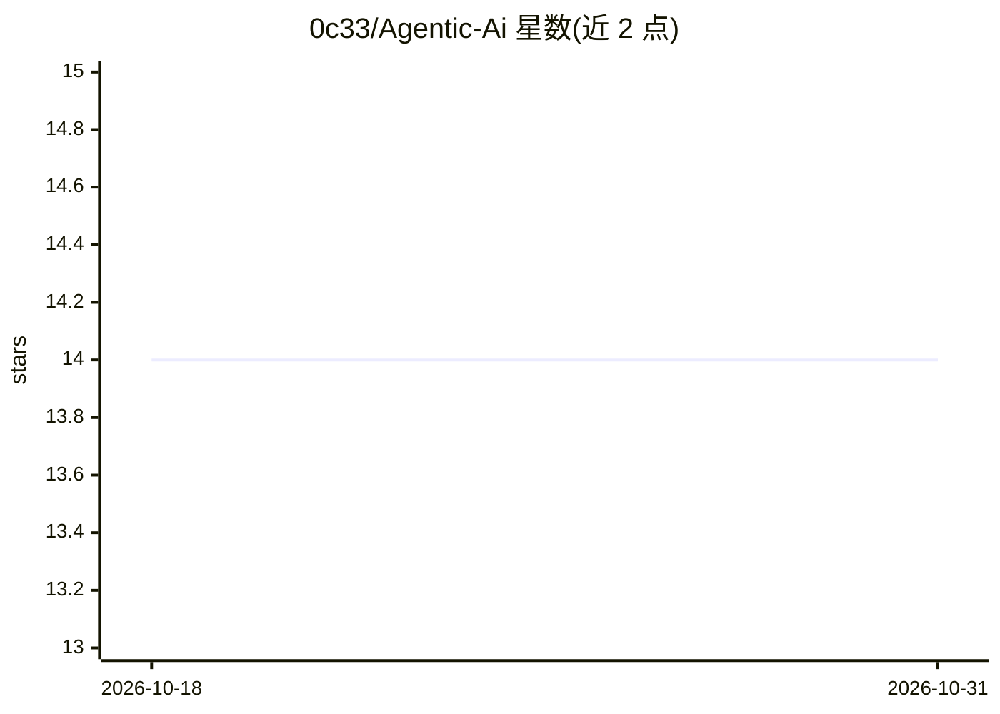

# 0c33/Agentic-Ai

⭐ 14 · Python · 推送 2026-07-29 · [GitHub](https://github.com/0c33/Agentic-Ai) · 个人维护

**闭环构建 Python agent 的 AI 系统：访谈、设计、测试、交付**

以循环方式构建 agent 的 AI 系统：接收原始想法后，通过澄清访谈循环提取结构化需求，迭代生成并 LLM 测试提示词，随后以自引用方式生成独立 Python agent 代码，在真实子进程中执行并按结构化评分循环改进，经人工批准后输出可运行的 .py 文件。面向开发者，处于 alpha 阶段，需手动配置模型名与端点，依赖本地 LLM 端点（测试于 Qwen3.6-35B via llama.cpp/vLLM）。每个退出点均设人工审批门。

## 筛选速览

| 维度 | 判定 | 备注 |
|---|---|---|
| AI 角色 | `ai-ecosystem` | LLM/agent 周边工具 |
| 许可风险 | `none` | — |
| 部署形态 | `library` | 以包/库形式分发 |
| 模型依赖 | local-ok | 支持本地模型 |
| 硬件要求 | — | 无带数字的原话,不猜 |
| 安装摩擦 | `low` | 无编译、无系统依赖或容器化 |
| 成熟度 | `idea` | |

## 能力要点

- 澄清循环持续提问直到 LLM 判定完全理解需求
- 两阶段测试：提示词 LLM 测试 + 生成的 Python 代码真实子进程执行
- 自引用代码生成：注入 main.py 源码作为结构参考
- 结构化 LLM 评分与人工批准门驱动迭代

## 适用场景

- 从模糊想法出发迭代生成可运行的独立 Python agent
- 在人工审批节点控制 agent 的设计与代码质量
- 使用本地 LLM 端点离线构建 agent

## 场景标签

`提示工程` `代码生成` `Agent 框架` · 领域:Agent 开发

## 证据(README 行号)

> L3: A closed-loop AI system that takes a raw idea, interviews the user until it fully understands it, iteratively design
> L28: - Loads LLM via LangChain `init_chat_model` using an OpenAI-compatible endpoint (`localhost:8080/v1`).

## 星数曲线

2026-10-18 14 → 2026-10-31 14（+0）

---
*卡片 v1 · prompt 1.4 · 生成 2026-10-31 · 置信度 high · 依据 README sha `072c44eb2521` · [字段定义](../../DATASET.md)*
