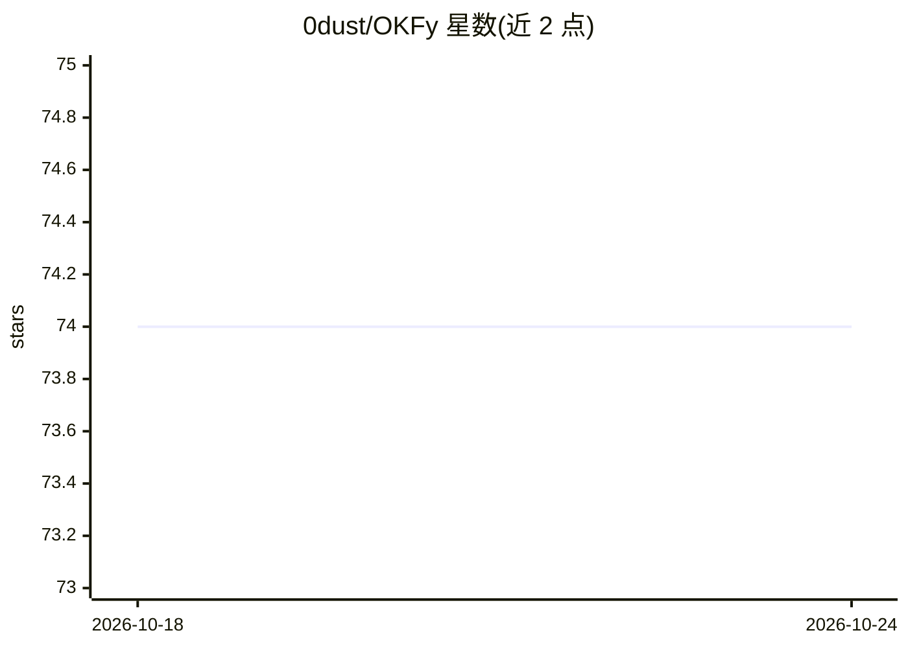

# 0dust/OKFy

⭐ 74 · TypeScript · MIT · 推送 2026-08-17 · [GitHub](https://github.com/0dust/OKFy) · 个人维护

**把文档转成 agent 可检索的本地知识包（MCP 服务器）**

npm 包（okfy-ai）与 CLI：把文档网站或 Markdown/Obsidian 文件夹爬取/导入为 Open Knowledge Format v0.1 格式的类型化、带链接的 Markdown bundle，通过本地只读 MCP 服务器让 Claude、Codex、Cursor 等 coding agent 执行确定性词法检索（search_concepts/read_concept/get_neighbors），并返回原始出处。无需 LLM API key 或嵌入服务，支持多源 workspace、源刷新（stale-while-refresh/blocking/off）、静态 HTML Inspector 与程序化 API。限制：不解析 Canvas/PDF/图片等，不做语义/向量检索。

## 筛选速览

| 维度 | 判定 | 备注 |
|---|---|---|
| AI 角色 | `ai-ecosystem` | LLM/agent 周边工具 |
| 许可风险 | `permissive` | MIT |
| 部署形态 | `library` | 以包/库形式分发 |
| 模型依赖 | — | README 未给出锁定关系 |
| 硬件要求 | — | 无带数字的原话,不猜 |
| 安装摩擦 | `low` | 无编译、无系统依赖或容器化 |
| 成熟度 | — | 结构信号不足 |

## 能力要点

- 文档爬取/本地导入生成 Git 可 diff 的 OKF bundle
- 本地只读 MCP 服务器暴露 6 个检索工具，无需 LLM key
- 确定性词法检索并保留原始 URL/文件出处
- 支持多源 workspace、源新鲜度管理与 HTML Inspector

## 适用场景

- 给 coding agent 提供可检视、带出处的项目/产品文档
- 把团队 Obsidian vault 转成 agent 可检索的知识包
- 在多个文档源上做来源感知的检索与去歧义

## 场景标签

`Agent 记忆` `知识库管理` · 领域:Agent 开发

## 证据(README 行号)

> L25: OKFy turns documentation websites and Markdown folders into Open Knowledge Format v0.1-conformant bundles: typed, l
> L267: The MCP server exposes read-only tools. Auto-refresh is server-side source maintenance, not an agent-callable writ
> L57: No embedding service or LLM API key is required. Website sources are cached under `~/.okfy` and can refresh when st

## 星数曲线

2026-10-18 74 → 2026-10-24 74（+0）

---
*卡片 v1 · prompt 1.4 · 生成 2026-10-24 · 置信度 high · 依据 README sha `d97f2f55f81d` · [字段定义](../../DATASET.md)*
