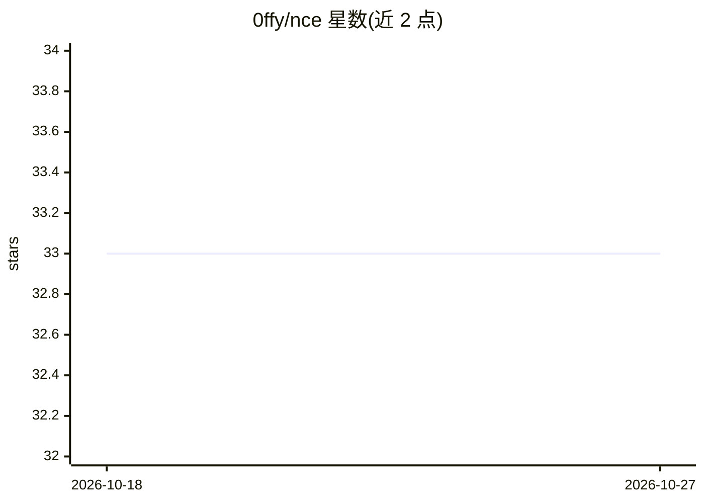

# 0ffy/nce

⭐ 33 · Python · MIT · 推送 2026-06-03 · [GitHub](https://github.com/0ffy/nce) · 个人维护

**PyTorch 实现 NCE 训练能量基模型（2D 数据集）**

在 2D 玩具数据集上实现噪声对比估计（NCE）训练能量基模型的 PyTorch 代码：将归一化常数 Z 作为可训练参数 c=logZ，通过数据分布与噪声分布（多元高斯）之间的逻辑回归分类目标来训练，优化器为 Adam。提供 8gaussians、2spirals、checkerboard、rings、pinwheel 五个数据集，每个 epoch 保存密度图，可生成 gif 可视化。安装方式为 git clone 后 pip install -r requirements.txt，训练命令为 python train.py；macOS 需设置 PYTORCH_ENABLE_MPS_FALLBACK=1。

## 筛选速览

| 维度 | 判定 | 备注 |
|---|---|---|
| AI 角色 | `ai-native` | 本体是模型或模型工具 |
| 许可风险 | `permissive` | MIT |
| 部署形态 | `library` | 以包/库形式分发 |
| 模型依赖 | — | README 未给出锁定关系 |
| 硬件要求 | — | 无带数字的原话,不猜 |
| 安装摩擦 | `low` | 无编译、无系统依赖或容器化 |
| 成熟度 | — | 结构信号不足 |

## 能力要点

- NCE 目标以非线性逻辑回归区分数据分布与噪声分布
- 归一化常数作为可训练参数 c=logZ
- 支持 5 种 2D 数据集并输出能量密度图/gif 可视化
- 兼容 macOS（MPS fallback 环境变量）

## 适用场景

- 学习/演示 NCE 训练能量基模型的机制
- 在 2D 玩具数据集上做生成建模实验
- 可视化训练过程中能量密度的变化

## 场景标签

`教程课程` · 领域:学习与行业

## 证据(README 行号)

> L5: This is an implementation of Noise Contrastive Estimation (NCE) in PyTorch on 2D dataset.
> L15: is the normalizing constant that is hard to compute. In NCE, the normalizing constant is treated as a trainable par

## 星数曲线

2026-10-18 33 → 2026-10-27 33（+0）

---
*卡片 v1 · prompt 1.4 · 生成 2026-10-25 · 置信度 mid · 依据 README sha `ff2e3fcd76f0` · [字段定义](../../DATASET.md)*
