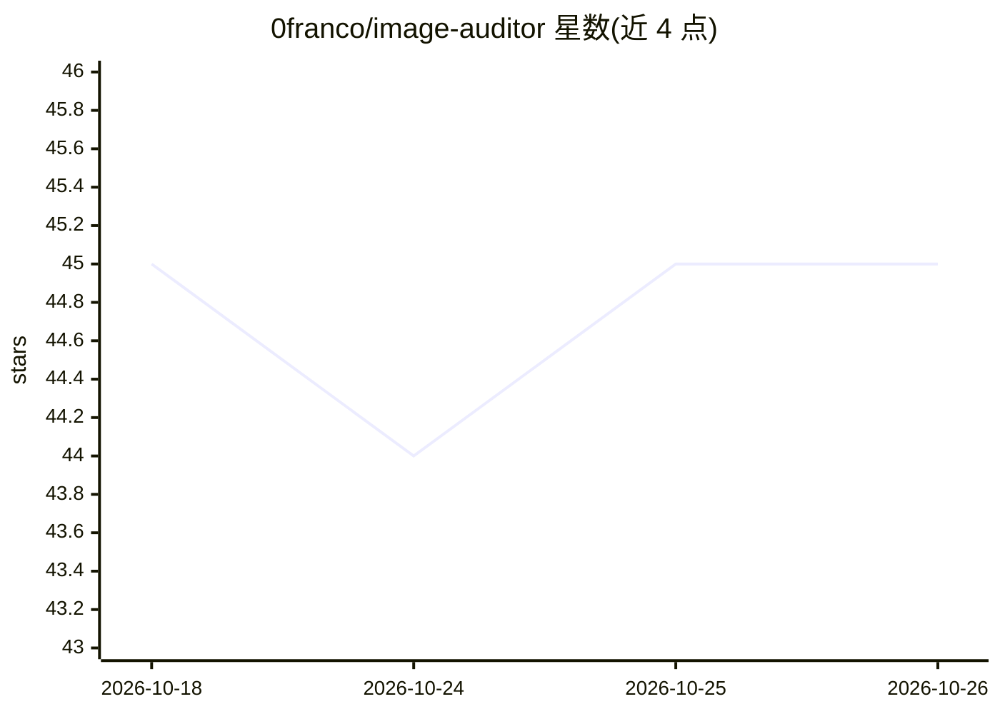

# 0franco/image-auditor

⭐ 45 · Rust · MIT · 推送 2026-07-05 · [GitHub](https://github.com/0franco/image-auditor) · 个人维护

**扫描代码库图片性能问题并用 LLM 修复的 Rust TUI 工具**

用 Rust 编写的终端工具：扫描 HTML、JSX、Vue、Svelte、PHP 等多种模板与框架文件，检测缺少 width/height、lazy loading、srcset、alt，及 PNG/JPG 未转 WebP/AVIF、文件超 200 KiB 等 6 类图片性能问题，按严重度列出行号，支持 JSON 导出与 TUI 过滤。可选启用 LLM（OpenAI/Anthropic/本地 Ollama）读取上下文生成最小补丁，经 diff 预览确认后原地修改并自动重扫。无 AI 配置时扫描器可独立运行。通过 cargo、Homebrew 或 deb 包安装。

## 筛选速览

| 维度 | 判定 | 备注 |
|---|---|---|
| AI 角色 | `ai-enhanced` | 去掉 AI 部分产品仍成立 |
| 许可风险 | `permissive` | MIT |
| 部署形态 | `desktop` | 安装包/桌面程序 |
| 模型依赖 | local-ok | 支持本地模型 |
| 硬件要求 | — | 无带数字的原话,不猜 |
| 安装摩擦 | `medium` | 含编译或系统依赖之一 |
| 成熟度 | — | 结构信号不足 |

## 能力要点

- 检测 6 类图片性能问题（CLS/LCP/TTI/SEO 相关）
- 多框架扫描：HTML/JSX/Vue/Svelte/PHP/Handlebars 等 14 种文件类型
- LLM 生成最小补丁，diff 预览后原地应用并自动重扫
- 扫描器可离线独立运行，AI 功能可选

## 适用场景

- 发布前排查全仓库图片导致的 Lighthouse 扣分
- 在 CI 中用 JSON 导出做图片性能检查
- 让 LLM 批量补全 img 标签缺失的属性

## 场景标签

`代码生成` · 领域:编码与开发

## 证据(README 行号)

> L86: **AI fixes are optional.** The scanner works with no configuration.

## 星数曲线

2026-10-18 45 → 2026-10-26 45（+0）

---
*卡片 v1 · prompt 1.4 · 生成 2026-10-25 · 置信度 high · 依据 README sha `d480288c9409` · [字段定义](../../DATASET.md)*
