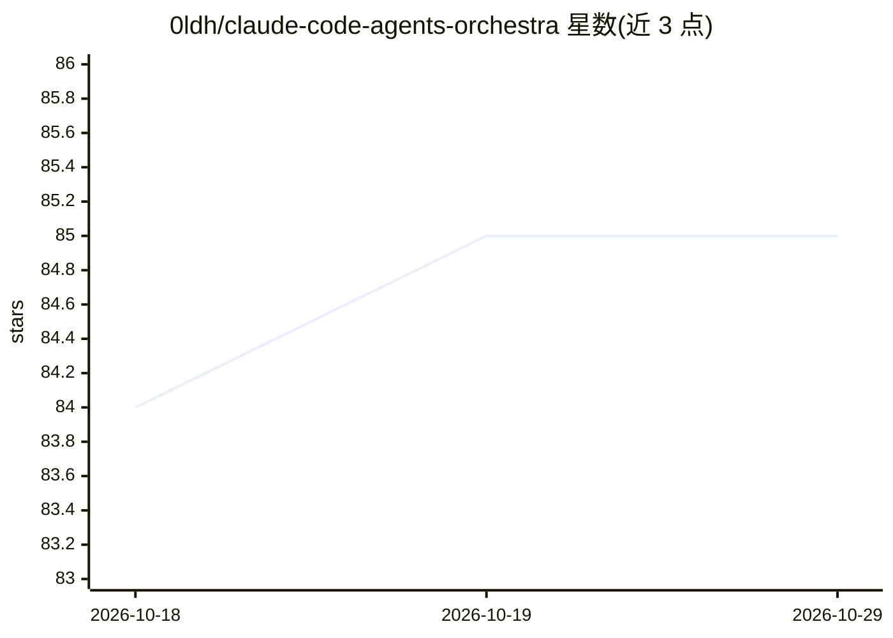

# 0ldh/claude-code-agents-orchestra

⭐ 85 · MIT · 推送 2026-10-08 · [GitHub](https://github.com/0ldh/claude-code-agents-orchestra) · 个人维护

**面向 Claude Code 的 47 个专业化 AI agent 提示词集合与编排示例**

为 Claude Code 提供按 10 个专业团队组织的 47 个专家 agent 提示词（架构、开发、QA、DevOps、语言专家、设计、内容、专业领域、工具等），可两种方式使用：直接以 @agent 方式调用单个专家，或将 CLAUDE.md.example 复制到 ~/.claude/CLAUDE.md 启用可选编排框架，由 Claude 担任 triage/委派/审批流的管理者。索引采用被动上下文加检索式选择设计，仅在相关时读取完整提示词。需要用户已安装 Claude Code CLI。

## 筛选速览

| 维度 | 判定 | 备注 |
|---|---|---|
| AI 角色 | `ai-ecosystem` | LLM/agent 周边工具 |
| 许可风险 | `permissive` | MIT |
| 部署形态 | `None` |  |
| 模型依赖 | locked-api |  |
| 硬件要求 | — | 无带数字的原话,不猜 |
| 安装摩擦 | `low` | 无编译、无系统依赖或容器化 |
| 成熟度 | — | 结构信号不足 |

## 能力要点

- 47 个专家 agent 按 10 个专业团队组织
- 可直接 @agent 调用，无需额外设置
- CLAUDE.md.example 提供可选编排框架：分类复杂度、委派专家、审批后执行
- 根上下文保留压缩索引，按检索路径加载完整专家提示词

## 适用场景

- 开发者为特定任务调用对应专家 agent（如安全审计、框架开发）
- 通过编排框架让 Claude 自动规划并协调多 agent 完成复杂任务
- 扩展现有工作流：按目录模式自建 agent 团队

## 场景标签

`多智能体` `提示工程` · 领域:Agent 开发

## 证据(README 行号)

> L8: > This project provides a collection of 47 specialized AI agents, turning a capable generalist like Claude into a wo
> L19: This collection of agents is the primary focus. You can use them with your own orchestration logic or use our provi
> L157: This repository includes an advanced orchestration framework in `CLAUDE.md.example`. See the Orchestration Example

## 星数曲线

2026-10-18 84 → 2026-10-29 85（+1）

---
*卡片 v1 · prompt 1.4 · 生成 2026-10-24 · 置信度 high · 依据 README sha `25fd8618546e` · [字段定义](../../DATASET.md)*
