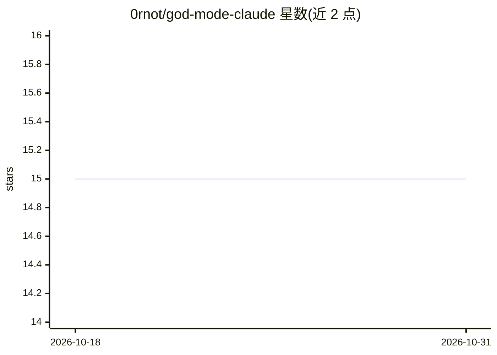

# 0rnot/god-mode-claude

⭐ 15 · MIT · 推送 2026-06-09 · [GitHub](https://github.com/0rnot/god-mode-claude) · 个人维护

**给 Claude Code 用的单个 CLAUDE.md 规则配置文件**

由单一 CLAUDE.md 文件构成的项目配置：通过 curl 下载后放入项目根目录即可生效，无额外配置。文件内包含四组规则——思考规则（先读后写、置信度低于95%时提问）、安全规则（禁止修改锁文件/.env 等、提交前确认）、质量规则（每函数写测试、函数与文件行数上限）、输出规则（diff-only、Conventional Commits）。文件控制在 200 行以内，README 称其依据是超长 CLAUDE.md 会降低模型遵循度。给 Claude Code 用户使用，也可改名为 .cursorrules 供其他 AI 编辑器参考。

## 筛选速览

| 维度 | 判定 | 备注 |
|---|---|---|
| AI 角色 | `ai-ecosystem` | LLM/agent 周边工具 |
| 许可风险 | `permissive` | MIT |
| 部署形态 | `None` |  |
| 模型依赖 | — | README 未给出锁定关系 |
| 硬件要求 | — | 无带数字的原话,不猜 |
| 安装摩擦 | `low` | 无编译、无系统依赖或容器化 |
| 成熟度 | — | 结构信号不足 |

## 能力要点

- 单个 CLAUDE.md 文件，curl 下载放入项目根目录即用
- 四组规则：思考/安全/质量/输出，含强制测试验证循环
- 文件控制在 200 行内，带可自定义的 Tech Stack/Commands 段落
- 支持改为 .cursorrules 供 Cursor 等其他 AI 编辑器使用

## 适用场景

- 让 Claude Code 在我的项目里遵守文件边界与测试验证流程
- 为项目快速生成一套可定制的编码规则基线
- 规范 AI 助手的提交信息与输出格式

## 场景标签

`提示工程` · 领域:Agent 开发

## 证据(README 行号)

> L16: A single `CLAUDE.md` file that makes Claude Code mass dramatically better at its job.
> L21: curl -o CLAUDE.md https://raw.githubusercontent.com/0rnot/god-mode-claude/main/CLAUDE.md

## 星数曲线

2026-10-18 15 → 2026-10-31 15（+0）

---
*卡片 v1 · prompt 1.4 · 生成 2026-10-31 · 置信度 high · 依据 README sha `f2c979491b01` · [字段定义](../../DATASET.md)*
