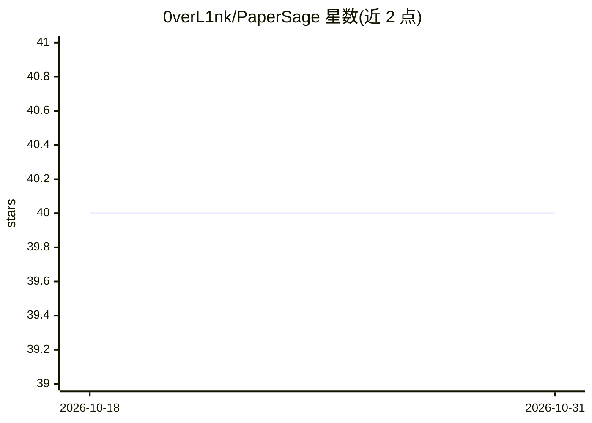

# 0verL1nk/PaperSage

⭐ 40 · Python · MIT · 推送 2026-09-24 · [GitHub](https://github.com/0verL1nk/PaperSage) · 个人维护 · 中文 README

**面向本地资料的可追溯 AI 研究阅读工作台**

项目式论文/文档问答应用：导入 PDF、DOCX、PPTX、XLSX、图片或 TXT 后异步完成转换、PaddleOCR、分块与索引；提问时以 Dense 向量+全文+RRF 混合检索召回，回答带可点击引用，可依据 OCR 页码、坐标定位原文证据。Agent 侧由 Leader 在当前请求内调用 researcher/reviewer/writer 子代理，含消息压缩与长期记忆两层记忆，SQLite+LanceDB 本地保存，流式会话可恢复。提供桌面安装包（Electron）、pip 包与源码运行三种途径；回答模型需用户自行在设置或 .env 配置。

## 筛选速览

| 维度 | 判定 | 备注 |
|---|---|---|
| AI 角色 | `ai-native` | 本体是模型或模型工具 |
| 许可风险 | `permissive` | MIT |
| 部署形态 | `library` | 以包/库形式分发 |
| 模型依赖 | — | README 未给出锁定关系 |
| 硬件要求 | — | 无带数字的原话,不猜 |
| 安装摩擦 | `medium` | 含编译或系统依赖之一 |
| 成熟度 | — | 结构信号不足 |

## 能力要点

- 混合检索（Dense+全文+RRF）且回答引用可回溯到原文页面与 OCR 坐标
- Leader 委派 researcher/reviewer/writer 子代理，委派与证据绑定、不可递归
- 两层记忆：会话内消息压缩 + 异步结构化长期记忆
- PDF/图片 OCR 保存页码、多边形与置信度，跨页证据多位置保留

## 适用场景

- 把自己的论文和文档建成项目资料库做带引用的问答
- 在研究中核对每个结论的原文出处与 OCR 高亮位置
- 用多角色分工完成文献调研、审阅与写作任务

## 场景标签

`文档问答` `科研工具` · 领域:知识与检索

## 证据(README 行号)

> L5:  面向本地资料的可追溯 AI 研究工作台。
> L14: PaperSage 把资料库、研究会话和引用证据放在同一个项目里。导入自己的文档后，可以立刻开始提问；解析、OCR 和索引在后台完成。每个结论都应能回到对应资料的页面和位置核对，而不只是得到一段聊天回答。
> L33: - **混合 RAG 与证据预览**：Dense 向量、全文检索和 RRF 共同召回；回答只引用实际采用的证据，点击后可查看原文页面与 OCR 高亮位置。

## 星数曲线

2026-10-18 40 → 2026-10-31 40（+0）

---
*卡片 v1 · prompt 1.4 · 生成 2026-10-25 · 置信度 high · 依据 README sha `24f7ba518578` · [字段定义](../../DATASET.md)*
