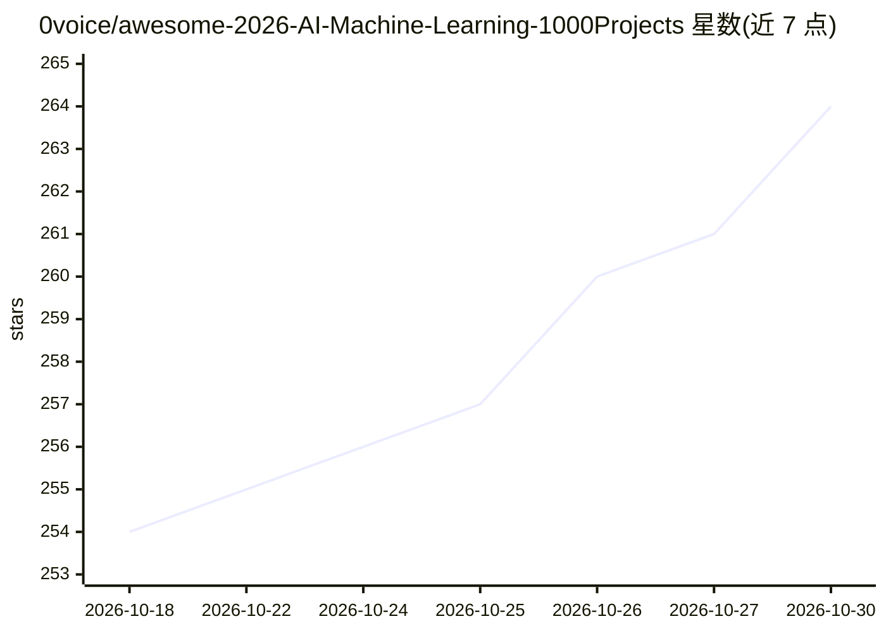

# 0voice/awesome-2026-AI-Machine-Learning-1000Projects

⭐ 264 · 推送 2026-03-23 · [GitHub](https://github.com/0voice/awesome-2026-AI-Machine-Learning-1000Projects) · 组织维护 · 中文 README

**1000+ 机器学习开源项目策展清单，覆盖入门到面试全场景**

由 0voice 维护的机器学习项目聚合清单：从 GitHub、Kaggle、学术社区收录 1000+ 开源项目与学习资源，按入门、提升、毕设、面试四个层级组织，另含 LLM 资源与算法面经分类。条目覆盖 CV、NLP、传统机器学习、深度学习等方向，每条附中文简介。仓库本身为纯清单，不含可运行代码，持续更新中，声明仅用于学习交流。

## 筛选速览

| 维度 | 判定 | 备注 |
|---|---|---|
| AI 角色 | `ai-knowledge` | 知识聚合/清单类 |
| 许可风险 | `none` | — |
| 部署形态 | `None` |  |
| 模型依赖 | — | README 未给出锁定关系 |
| 硬件要求 | — | 无带数字的原话,不猜 |
| 安装摩擦 | `medium` | 含编译或系统依赖之一 |
| 成熟度 | — | 结构信号不足 |

## 能力要点

- 收录 1000+ 开源机器学习项目与教程资源
- 入门/提升/毕设/面试四级分类导航
- 覆盖 CV、NLP、传统机器学习、深度学习方向
- 定期同步 GitHub、Kaggle、学术社区资源

## 适用场景

- 初学者按入门级分类找可直接跑通的练手项目
- 毕业设计或课程设计选题参考
- 求职面试前按面试级分类准备项目材料

## 场景标签

`精选清单` · 领域:学习与行业

## 证据(README 行号)

> L3:  💼 收录和整理 1000+ 个高质量、开源的机器学习项目，新手能直接跑通的机器学习实战合集，覆盖 入门 / 提升 / 毕设 / 面试 全场景
> L28: 本仓库会定期同步GitHub、Kaggle、学术社区的优质开源项目，重点覆盖：

## 星数曲线

2026-10-18 254 → 2026-10-30 264（+10）

---
*卡片 v1 · prompt 1.4 · 生成 2026-10-22 · 置信度 high · 依据 README sha `daa62974d22a` · [字段定义](../../DATASET.md)*
