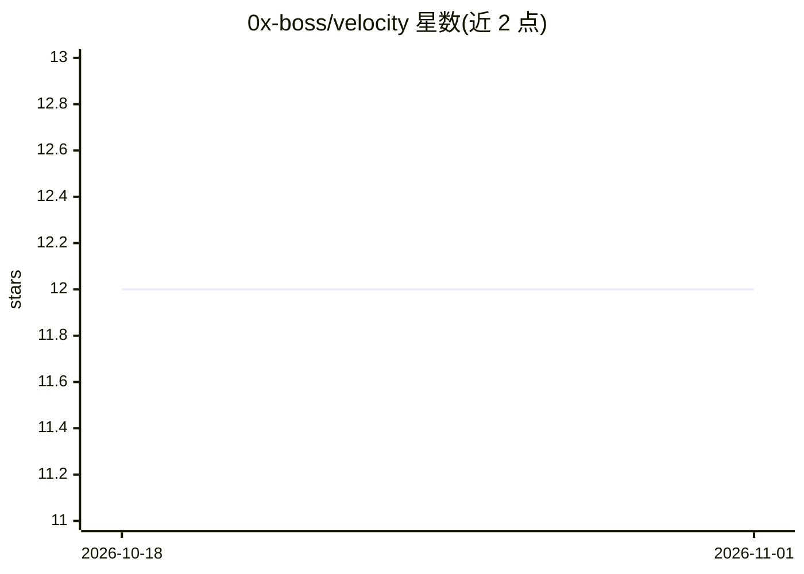

# 0x-boss/velocity

⭐ 12 · TypeScript · NOASSERTION · 推送 2025-11-16 · [GitHub](https://github.com/0x-boss/velocity) · 个人维护

**用自然语言或 YAML 生成动效视频的 AI 辅助视频编辑器**

基于 React/Remotion 的动效视频创作工具：用户以自然语言或结构化 YAML 描述场景，由 LLM 生成 YAML（借助 docs/docs.md 与 docs/prompt.md 两个文档引导模型输出合法场景），解析器将 YAML 构建为 React 组件，经时间线驱动动画并实时预览，最终通过 Remotion 渲染导出。支持文本/图像/形状/路径等元素、Anime 风格动画、3D 变换与布局系统。项目已声明暂停开发，解析器存在较多 bug。

## 筛选速览

| 维度 | 判定 | 备注 |
|---|---|---|
| AI 角色 | `ai-native` | 本体是模型或模型工具 |
| 许可风险 | `none` | NOASSERTION |
| 部署形态 | `None` |  |
| 模型依赖 | — | README 未给出锁定关系 |
| 硬件要求 | — | 无带数字的原话,不猜 |
| 安装摩擦 | `low` | 无编译、无系统依赖或容器化 |
| 成熟度 | `idea` | |

## 能力要点

- 自然语言/YAML 描述生成动效场景
- YAML→React 组件解析器与时间线动画
- 基于 Remotion 的实时预览与渲染导出
- 提供 LLM 提示词文档引导模型输出合法 YAML

## 适用场景

- 用自然语言快速生成动效动画视频
- 以 YAML 手工编写可控的动效场景
- 借助 ChatGPT/Claude 等 LLM 批量产出场景文件

## 场景标签

`视频生成` · 领域:内容生成

## 证据(README 行号)

> L9: Velocity is an AI‑assisted video editor that lets you create professional motion graphics by describing your vision 
> L41: Velocity pairs well with an LLM (ChatGPT, Claude, etc.) to author scenes:

## 星数曲线

2026-10-18 12 → 2026-11-01 12（+0）

---
*卡片 v1 · prompt 1.4 · 生成 2026-11-01 · 置信度 high · 依据 README sha `8e331ac86af7` · [字段定义](../../DATASET.md)*
