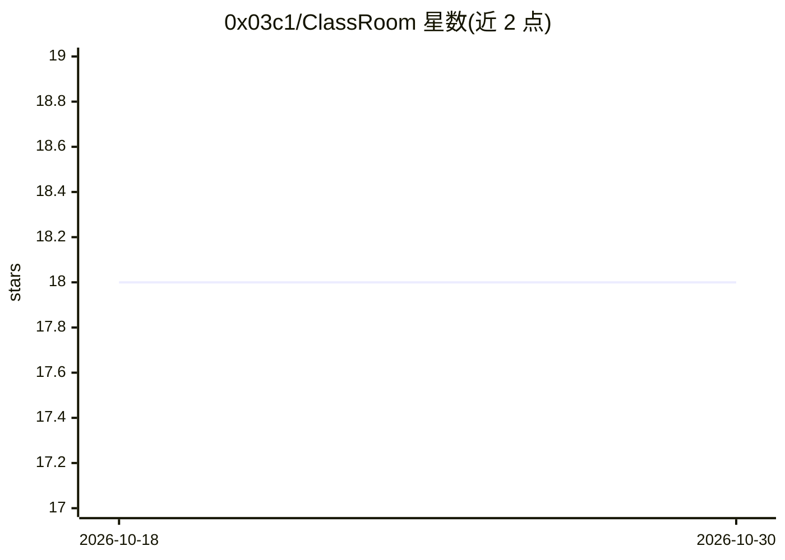

# 0x03c1/ClassRoom

⭐ 18 · C · 推送 2026-10-23 · [GitHub](https://github.com/0x03c1/ClassRoom) · 个人维护

**高校多门课程的授课资料汇编（按学校/课程组织）**

汇集作者在多所高校（CESAR、Estácio、FICR、SENAC、UniRios）授课使用的教学材料，按大学和课程文件夹组织，涵盖编程、网络安全、数据科学、Web 开发、数据库、云计算、Node.js、软件质量、计算机体系结构、人工智能等课程。内容仅供学术用途，允许使用与分享但要求注明作者。仓库本身不提供软件安装或运行方式，仅作为课件资料集合。

## 筛选速览

| 维度 | 判定 | 备注 |
|---|---|---|
| AI 角色 | `ai-knowledge` | 知识聚合/清单类 |
| 许可风险 | `none` | — |
| 部署形态 | `None` |  |
| 模型依赖 | — | README 未给出锁定关系 |
| 硬件要求 | — | 无带数字的原话,不猜 |
| 安装摩擦 | `low` | 无编译、无系统依赖或容器化 |
| 成熟度 | — | 结构信号不足 |

## 能力要点

- 覆盖 5 所院校、17 门课程的教学材料
- 按大学-课程两级目录组织
- 含人工智能、数据科学、云计算等技术课程内容

## 适用场景

- 查找巴西高校多门计算机相关课程的授课材料
- 作为自学编程、安全、数据科学等课程的参考资料
- 教师备课或复用课件素材

## 场景标签

`教程课程` · 领域:学习与行业

## 证据(README 行号)

> L3: Este repositório reúne os materiais utilizados em disciplinas que ministrei em diferentes instituições de ensino sup
> L36:  - Inteligência Artificial (IA)

## 星数曲线

2026-10-18 18 → 2026-10-30 18（+0）

---
*卡片 v1 · prompt 1.4 · 生成 2026-10-29 · 置信度 high · 依据 README sha `664214272850` · [字段定义](../../DATASET.md)*
