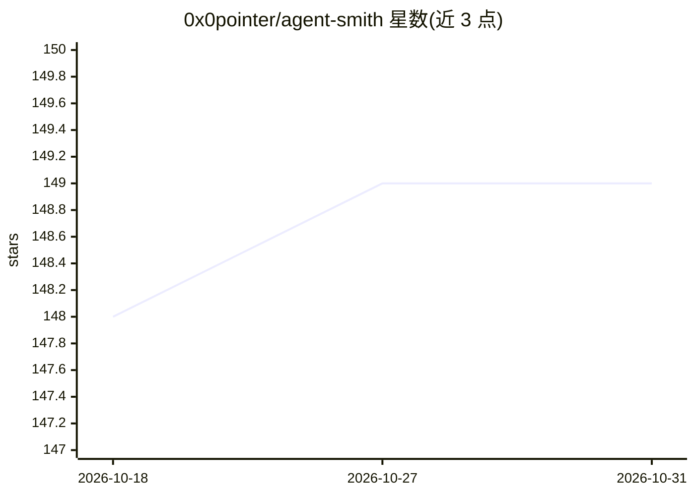

# 0x0pointer/agent-smith

⭐ 149 · Python · AGPL-3.0 · 推送 2026-10-28 · [GitHub](https://github.com/0x0pointer/agent-smith) · [官网](https://discord.gg/Pg6gBbr2Vj) · 组织维护

**AI 驱动的渗透测试框架：LLM 规划并执行授权安全测试**

面向安全测试人员的渗透测试框架，将 LLM 作为决策大脑：技能（prompt）教授方法论而非固定 payload 库，由模型生成针对目标的攻击。提供 50+ 工具、35+ 技能（如 /pentester、/codebase ASVS 审查、/ai-redteam），技能间可自动链式调用。支持自带任意 LLM 客户端（Claude Code、Codex、OpenCode、任何 MCP 客户端，含 Ollama 等本地模型）。扫描器默认运行在临时 Docker 容器中沙箱化，服务端强制成本/时间/调用次数限制。通过 git clone 与安装脚本安装，产出报告、PoC、补丁、威胁模型与 CVE 提交包。仅限授权测试。

## 筛选速览

| 维度 | 判定 | 备注 |
|---|---|---|
| AI 角色 | `ai-native` | 本体是模型或模型工具 |
| 许可风险 | `viral` | AGPL-3.0 |
| 部署形态 | `None` |  |
| 模型依赖 | — | README 未给出锁定关系 |
| 硬件要求 | — | 无带数字的原话,不猜 |
| 安装摩擦 | `low` | 无编译、无系统依赖或容器化 |
| 成熟度 | — | 结构信号不足 |

## 能力要点

- 35+ 技能（prompt 形式）教授方法论，LLM 生成实际攻击
- 自带 LLM：Claude Code / Codex / OpenCode / 任意 MCP 客户端，可完全本地运行
- 扫描器默认沙箱化于临时 Docker 容器，服务端强制预算限制
- 每次扫描被动生成结构化事件流，可蒸馏为本地 LoRA 适配器

## 适用场景

- 在授权目标上执行从侦察到报告的完整渗透测试
- 对代码库做 OWASP ASVS 5.0 白盒审查
- 对 LLM 应用做 OWASP LLM Top 10 红队测试
- 中断/完成的扫描可快照恢复，跳过已测试部分

## 场景标签

`网络安全` `代码审查` · 领域:编码与开发

## 证据(README 行号)

> L16: - 🧠 **The LLM is the brain, not a payload library.** Skills teach *methodology*; the LLM invents the actual attacks
> L18: - 🛠 **Bring your own LLM.** Claude Code, OpenAI Codex, OpenCode (any provider — OpenAI, Gemini, Ollama, OpenRouter,
> L27: Most pentest automation ships a giant payload library and runs it linearly. agent-smith does the opposite. **Skills

## 星数曲线

2026-10-18 148 → 2026-10-31 149（+1）

---
*卡片 v1 · prompt 1.4 · 生成 2026-10-22 · 置信度 high · 依据 README sha `51ab47c68950` · [字段定义](../../DATASET.md)*
