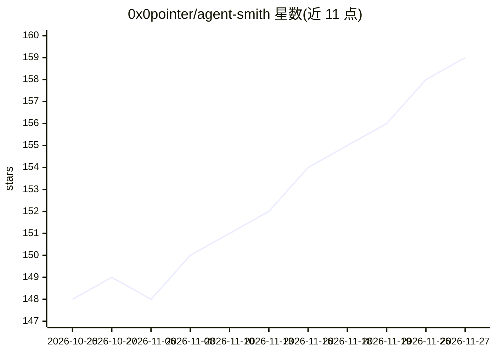

# 0x0pointer/agent-smith

⭐ 159 · Python · AGPL-3.0 · 推送 2026-11-26 · [GitHub](https://github.com/0x0pointer/agent-smith) · [官网](https://discord.gg/Pg6gBbr2Vj) · 个人维护

**面向授权渗透测试者的 LLM 驱动 Agent 框架**

以 MCP 服务器接入 Claude Code / Codex / OpenCode 等 LLM 客户端的渗透测试框架，提供 35+ 技能（如 /pentester 全流程扫描、/codebase 白盒 ASVS 审查、/ai-redteam、/remediate 补丁生成），由 LLM 决定攻击路径并聚合 50+ 工具输出。所有扫描器在临时 Docker 容器中运行，服务端强制成本/时间/调用次数限额；产出含 PoC、威胁模型、CVE 提交包等交付物，扫描过程以事件流形式留作训练数据，支持从先前扫描恢复与召回。要求 Docker Desktop、Poetry 与一个 LLM 客户端。

## 筛选速览

| 维度 | 判定 | 备注 |
|---|---|---|
| AI 角色 | `ai-native` | 本体是模型或模型工具 |
| 许可风险 | `viral` | AGPL-3.0 |
| 部署形态 | `None` |  |
| 模型依赖 | local-ok | 支持本地模型 |
| 硬件要求 | — | 无带数字的原话,不猜 |
| 安装摩擦 | `low` | 无编译、无系统依赖或容器化 |
| 成熟度 | — | 结构信号不足 |

## 能力要点

- 技能即提示词：教 LLM 方法论，攻击路径由模型自行决定
- 所有扫描器沙箱化于临时 Docker 容器，服务端强制成本/时间限额
- Augmented/Autonomous 两种模式，localhost:7777 实时仪表盘可中途介入
- 扫描事件流可作为行为克隆数据集，QLoRA 蒸馏出本地 LoRA 适配器

## 适用场景

- 对自有或获书面授权的系统执行端到端渗透测试
- 对代码库做 OWASP ASVS 5.0 白盒审查
- 对 LLM 应用做 OWASP LLM Top 10 / 提示注入红队测试
- CI/CD 流水线中周期性红队演练与持续测试

## 场景标签

`网络安全` `Agent 框架` · 领域:Agent 开发

## 证据(README 行号)

> L16: - 🧠 **The LLM is the brain, not a payload library.** Skills teach *methodology*; the LLM invents the actual attacks
> L18: - 🛠 **Bring your own LLM.** Claude Code, OpenAI Codex, OpenCode (any provider — OpenAI, Gemini, Ollama, OpenRouter,
> L127:         └── MCP server (python -m mcp_server)

## 星数曲线

2026-10-25 148 → 2026-11-27 159（+11）

---
*卡片 v1 · prompt 1.4 · 生成 2026-11-27 · 置信度 high · 依据 README sha `f466d7516d66` · [字段定义](../../DATASET.md)*
