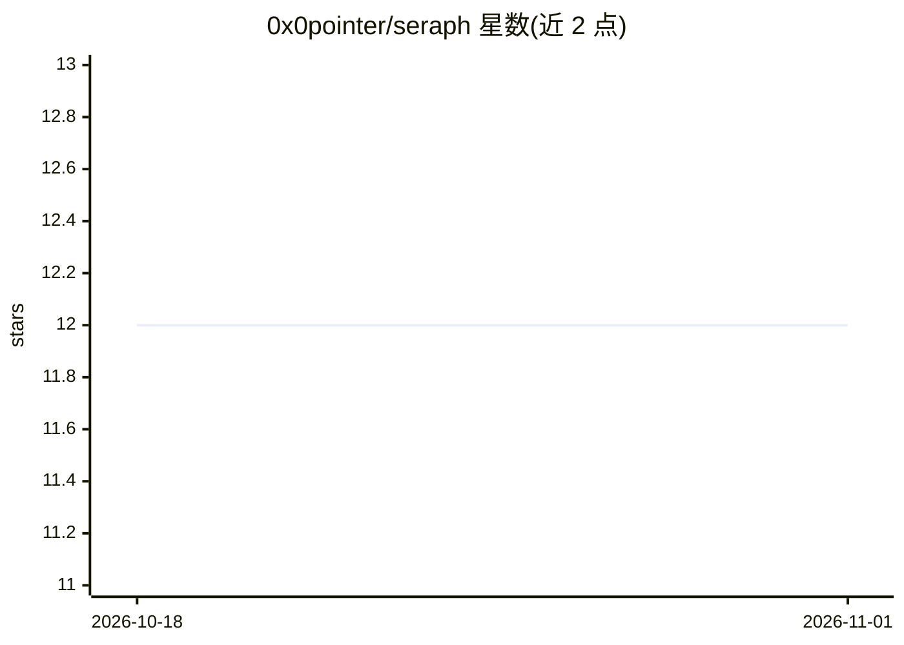

# 0x0pointer/seraph

⭐ 12 · Python · AGPL-3.0 · 推送 2026-06-30 · [GitHub](https://github.com/0x0pointer/seraph) · [官网](https://discord.gg/Pg6gBbr2Vj) · 组织维护

**面向 LLM 应用的透明安全代理，双层护栏扫描请求与响应**

Seraph 是部署在应用与 LLM 提供商之间的安全代理：应用端点改指向 Seraph 后无需改代码，所有请求经双层护栏管线扫描。Tier 1 用 NVIDIA NeMo Guardrails 作语义白名单（Colang flows 定义允许的意图）；Tier 2 通过 LangGraph 运行本地 Mistral 7B 模型检测提示注入、越狱、数据外泄与策略违规。单一 YAML 配置，无数据库与前端，支持流式透传与热重载配置。面向需要为 LLM 应用接入安全审计与访问控制的开发者。

## 筛选速览

| 维度 | 判定 | 备注 |
|---|---|---|
| AI 角色 | `ai-ecosystem` | LLM/agent 周边工具 |
| 许可风险 | `viral` | AGPL-3.0 |
| 部署形态 | `self-host` | docker 或自建部署 |
| 模型依赖 | — | README 未给出锁定关系 |
| 硬件要求 | — | 无带数字的原话,不猜 |
| 安装摩擦 | `low` | 无编译、无系统依赖或容器化 |
| 成熟度 | — | 结构信号不足 |

## 能力要点

- 任意 LLM API 端点的 drop-in 替换，零代码改动
- 双层防御：NeMo Guardrails 语义白名单 + 本地 Mistral 7B 评估
- 单一 YAML 配置，无数据库、无前端
- 支持流式 SSE 透传与 /reload 热重载

## 适用场景

- 在应用与 LLM 提供商之间拦截提示注入与越狱请求
- 以语义白名单限定用户可提问范围
- 不修改代码为现有 LLM 应用增加安全扫描层

## 场景标签

`网络安全` · 领域:学习与行业

## 证据(README 行号)

> L7: Seraph is a transparent security proxy for LLM applications. Point your app at Seraph instead of the LLM — it scans 
> L10: - Works with **any LLM provider** (OpenAI, Anthropic, Azure, Ollama, vLLM, etc.)

## 星数曲线

2026-10-18 12 → 2026-11-01 12（+0）

---
*卡片 v1 · prompt 1.4 · 生成 2026-11-01 · 置信度 mid · 依据 README sha `d1c2ffc433f3` · [字段定义](../../DATASET.md)*
