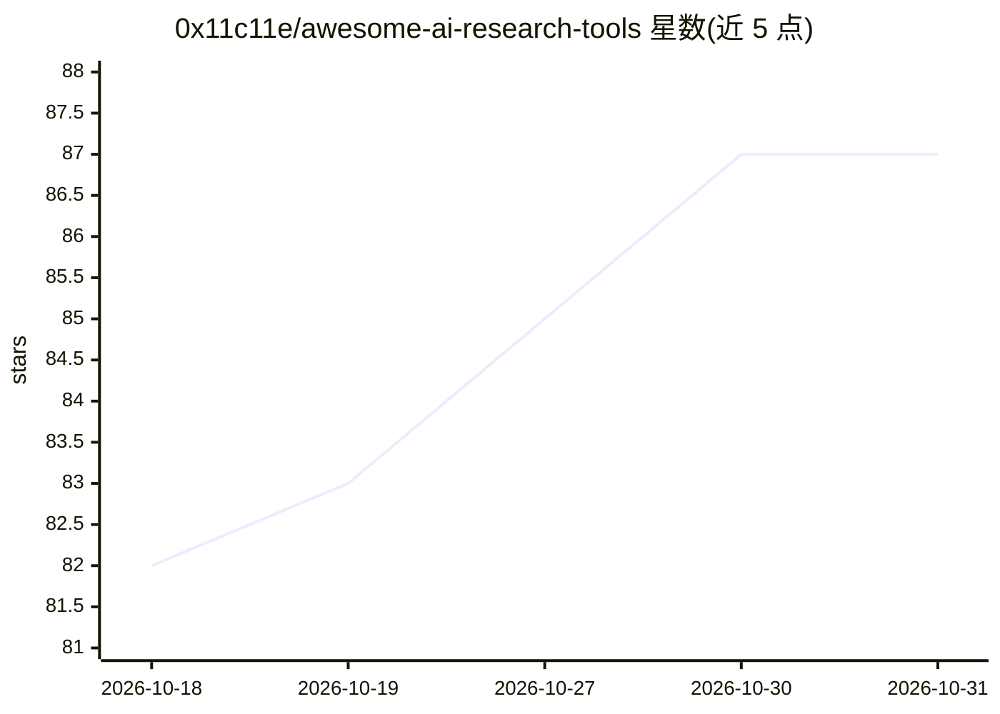

# 0x11c11e/awesome-ai-research-tools

⭐ 87 · CC0-1.0 · 推送 2026-10-08 · [GitHub](https://github.com/0x11c11e/awesome-ai-research-tools) · 个人维护

**面向科研全流程的 AI 工具策展清单（文献、引用、写作等）**

按研究流程阶段组织的 AI 工具清单：覆盖文献发现、科研 Agent、论文问答、引用管理、引文网络可视化、学术写作、数据分析、转录、开放数据集/API、笔记知识与资源追踪等类别，每条目附一句功能描述。清单声明链接经 2026 年 8 月核验，移除下线或转型工具，并附最近新增条目表格与移除记录。采用 CC0 许可，接受 PR。面向研究人员、学生与专业人士选用工具。

## 筛选速览

| 维度 | 判定 | 备注 |
|---|---|---|
| AI 角色 | `ai-knowledge` | 知识聚合/清单类 |
| 许可风险 | `viral` | CC0-1.0 |
| 部署形态 | `None` |  |
| 模型依赖 | — | README 未给出锁定关系 |
| 硬件要求 | — | 无带数字的原话,不猜 |
| 安装摩擦 | `low` | 无编译、无系统依赖或容器化 |
| 成熟度 | — | 结构信号不足 |

## 能力要点

- 按研究阶段（发现/阅读/引用/写作等）分类组织条目
- 声明全部链接经 2026 年 8 月实地核验
- 记录本轮新增条目与下线/转型移除的工具

## 适用场景

- 按研究阶段查找合适的 AI 辅助工具
- 了解科研 AI 工具生态中可用的开放数据集与 API
- 追踪科研 AI 工具的下线与迁移情况

## 场景标签

`科研工具` `精选清单` · 领域:学习与行业

## 证据(README 行号)

> L3: A curated list of AI-powered tools for academic and scientific research — refreshed and link-verified for 2026.
> L13: > Tools to accelerate every stage of the research pipeline — discovery, reading, citation, analysis, writing, and d

## 星数曲线

2026-10-18 82 → 2026-10-31 87（+5）

---
*卡片 v1 · prompt 1.4 · 生成 2026-10-24 · 置信度 high · 依据 README sha `15fb4dc83071` · [字段定义](../../DATASET.md)*
