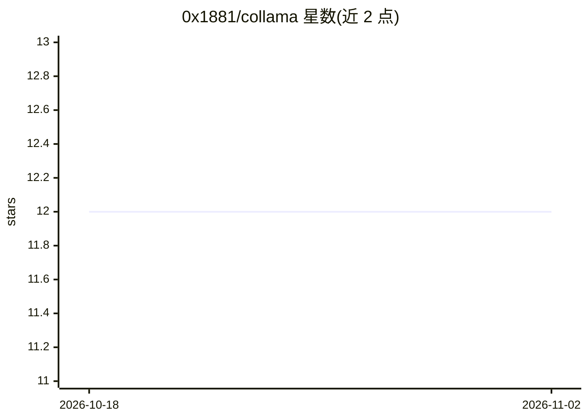

# 0x1881/collama

⭐ 12 · Jupyter Notebook · WTFPL · 推送 2026-03-22 · [GitHub](https://github.com/0x1881/collama) · 个人维护

**在 Google Colab 上一键运行 Ollama 模型的笔记本配置**

提供可在 Google Colab 中运行的 notebook，用于安装并运行 Ollama 及 Llama、Qwen、Deepseek、CodeLlama 等模型，面向无本地 GPU、需要快速原型的开发者。包含 LangChain 集成示例（prompt→response 流水线），并给出通过 Cloudflare Tunnel 从外部访问 Colab 内 Ollama 服务的配置步骤（需 Cloudflare 账号与域名）。README 声明限制：Colab 会话重启即重置、GPU 用量受限、大模型可能超出内存，且不面向生产环境，定位为快速测试与试验场。

## 筛选速览

| 维度 | 判定 | 备注 |
|---|---|---|
| AI 角色 | `ai-ecosystem` | LLM/agent 周边工具 |
| 许可风险 | `viral` | WTFPL |
| 部署形态 | `None` |  |
| 模型依赖 | local-ok | 支持本地模型 |
| 硬件要求 | — | 无带数字的原话,不猜 |
| 安装摩擦 | `low` | 无编译、无系统依赖或容器化 |
| 成熟度 | — | 结构信号不足 |

## 能力要点

- 一键在 Colab 上完成 Ollama 安装
- 支持运行 Llama、Qwen、Deepseek、CodeLlama 等模型
- LangChain 集成示例（prompt → response 流水线）
- 可选 Cloudflare Tunnel 实现外部访问

## 适用场景

- 没有本地 GPU 时快速测试各类开源 LLM
- 在 Colab 上搭建 LangChain + Ollama 工作流做原型
- 通过隧道从本地工具访问 Colab 中的模型服务

## 场景标签

`推理引擎` · 领域:训练与推理

## 证据(README 行号)

> L7: Collama is a minimal and practical setup to run Ollama models directly on Google Colab.
> L13: - One-click Ollama setup on Colab

## 星数曲线

2026-10-18 12 → 2026-11-02 12（+0）

---
*卡片 v1 · prompt 1.4 · 生成 2026-11-01 · 置信度 high · 依据 README sha `35764bd24f40` · [字段定义](../../DATASET.md)*
